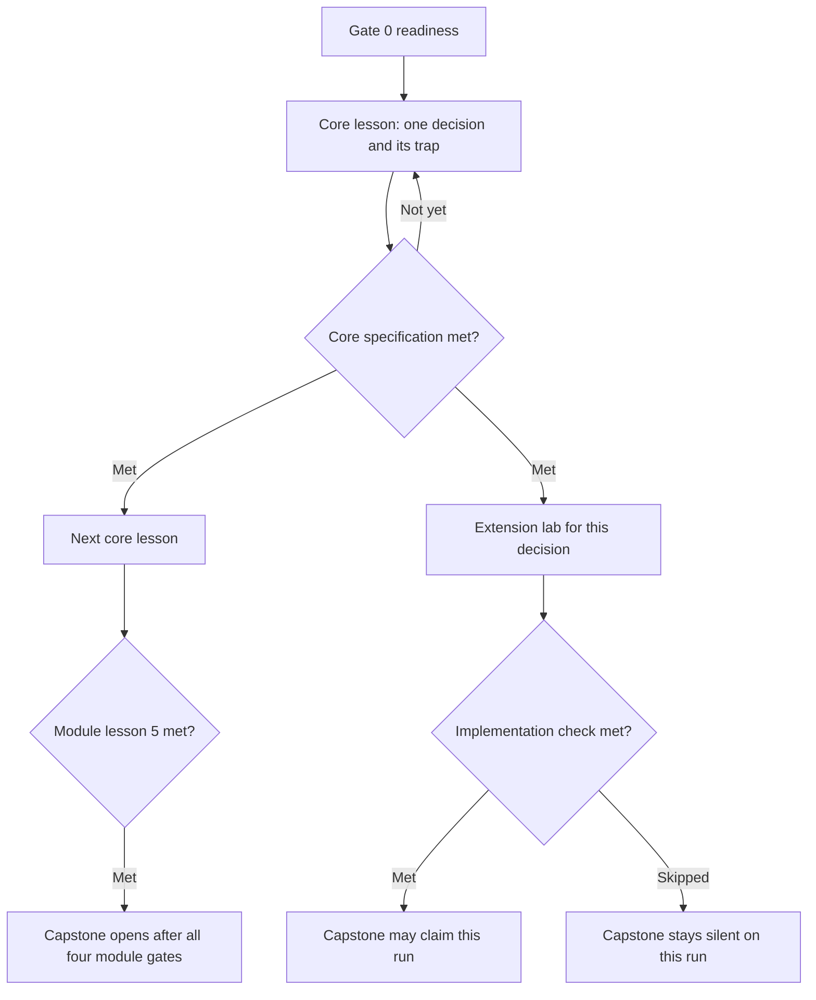

# Proposed progression

The twenty lessons stay, in order, with the traps listed in the author record. What changes is the required production. The core path is the decision. Extension labs are the subsystems that currently ride inside the lesson. The capstone is Module 4, Lesson 5. No duration is assigned. Prerequisites and exit criteria are.

This is a proposal for a later editor. It does not replace the curriculum understanding map, and it does not authorize deleting a trap. It does change what "required" means for `slice-lora`, `slice-hybrid`, `slice-acl`, and `slice-judge`. The author record keeps those slices required and keeps them off the advanced files. Here they stay required for the implementation bundle and the distinction record. They are not required to open the next core lesson. A mixed cohort cannot treat a LoRA slice as the only door.

## Gate 0

These are prerequisites for Lesson 1. They are specifications, not a course length.

| Specification | Met when |
| --- | --- |
| Technical reading | The learner can read the lesson's own word list and restate a case sentence as a claim, a request, or a fact |
| Terminal orientation | The learner can follow the existing terminal note far enough to run the version command the first chapter names |
| Python, for any check that runs | `python` or `python3` prints 3.12 or newer, as Lesson 1 already checks |
| Not required | Databases, APIs, cloud operations, machine learning, a health-system background, or prior tenure in any of the five roles |

The chapters teach the cluster's words. Gate 0 does not. A learner who cannot install Python may still complete Lesson 1's access request and interviews. The pipeline check stays not-yet, and Lesson 2 stays closed, until that check is met. There is no separate non-technical course. There is a shared decision record and an optional lab.

## Shape of a core lesson

Six chapters are the target. A lesson that needs a seventh chapter has picked up a second decision.

| Chapter | Job |
| --- | --- |
| Background | Supportive information: the case facts for this decision, the terms, the trap named as a situation rather than as the answer |
| Commit | A short written prediction, saved before the next chapter opens |
| Worked decision | The four beats in words: what arrives, what decides, what is refused, what is written. One completion only if the decision is a behavior |
| Check | The core specification, with feedback as in the assessment note |
| Comparison | The solution chapter, opened only after the commit exists and the check has run. The learner writes the four beats in their own sentences |
| Optional trainer | Unchanged: optional, and not the place the morning's answers hide |

Procedural information (which block is a picture, how to paste without formatting, which command to rerun) appears on the first lesson that needs it and fades. It is not re-taught as content.

A core chapter is one segment. It holds one of the rows above, not a second subsystem. If the current lesson runs from `00` through `10`, the extra chapters are almost certainly extension material or a second trap. Move the material. Keep the trap.

## Core path and exit criteria

Each row's exit criteria are the core specification. All of them are met, or the lesson is not yet met. The trap stays on that lesson either way.

### Module 1 — Prove the approach

| Lesson | Decision the core owns | Exit criteria |
| --- | --- | --- |
| 1 Arrival | The engagement in the cluster's words. A secret is refused. Clinical material is not pasted into an assistant | Access request has the four fields. Both interviews have notes. The zone note uses the lesson's classification words. The pipeline answers up and rejects a secret (`chk-repo`). The sample letter is not in `work/` |
| 2 The approach | Every problem has a family, including `no-model` and `blocked` | Every problem id is in `approach.md`. `p-triage` is blocked. `p-clock` and `p-slots` are not assigned to a language model. The split note says the same person can sit on both sides of a row split. The brief does not treat the sponsor sentence as a fact. Baseline scripts are run, not rewritten |
| 3 Intake | `wf-intake` ends in a held approval | The note and the labeled scenario say: approval is held, Friday is not counted as a working day, `h-ain` is not booked, and the in-force criteria version is the one the packet says is in force. Idempotency is described as refusing a second effect for the same `event_id` |
| 4 The agent | Status and booking are tools. A return waits for a person. A letter is data | The note names the tool for status, the hold for a return, and a refusal to book from a sentence inside a referral. A provided trace is classified as allowed or refused. Privilege and consent are named |
| 5 Score the proof | The proof has a human step and a list of what is not built | The diagram includes a human step. The design refuses triage and names residency, identity, and draft criteria as later work. The readout answers `steer-m01` on the recording pair. The emergency trace note matches the redirect rule |

**Module gate.** Lesson 5's exit criteria, including the recording. Lesson 2's families are still visible in the design.

### Module 2 — Put it in the cluster

| Lesson | Decision the core owns | Exit criteria |
| --- | --- | --- |
| 1 Sign in | A signed-in patient and a signed-in coordinator can open the assistant. Booking waits | The state note and the token note name the two signed-in parties, the assurance level the packet gives, and the FHIR field the new spec removed. Booking from the new shell is still waiting |
| 2 Feeds | The mart's wait number stays a claim. A cancellation is a clinic session | Patient-visible states are listed. The zone crossing is named. `session.cancelled` is described as a clinic session. The mart note refuses the wait number as truth |
| 3 The receipt | A suite fails when the seeded fault is on. Low-literacy tasks can be finished | The definition of done names the receipt switch. The learner states the assertion that must go red and the fault that triggers it. Usability notes cover `status-short` and `caregiver` |
| 4 Deploy | The URL's zone, the probe, and the hash are explicit. The process is not root. Logs do not carry a national id | `deployment.md` states those five decisions and points at the policy id. Operator steps match the zone |
| 5 The Ain change | A booking at Ain stays on the nightly file | The deployment note and the readout refuse live slots. The change request is sequenced. The note names what Stage 2 monitoring still lacks. Recording pair for this module's steering questions |

**Module gate.** Lesson 5's exit criteria. The Lesson 1 rule that booking is not free still holds.

### Module 3 — Make the answers honest

| Lesson | Decision the core owns | Exit criteria |
| --- | --- | --- |
| 1 Honest data | One person is not one row. Labels follow the current guideline | `patients.md` refuses to merge a mother and a newborn. `classes.md` follows `ann-v2`, not clerk labels from the superseded guideline. PHI is kept off `ext-large`. A canary scan is named before any share |
| 2 The adapter | A registered adapter, inside quota and price, or no custom model. The external fine-tune is closed | `approach.md` keeps `p-info` on retrieval, `p-dna` on classical methods, and `p-triage` blocked. `residency.md` names the register, the quota, and the price cap. An unregistered hash is refused |
| 3 Cite | A citation is an in-force document the asker may see | `refusal.md` covers no-document. `audience.md` refuses a staff leaflet to a patient and refuses `circ-ramadan-unauth`. In-flight referrals keep the criteria version they started on |
| 4 Measure | The benchmark names the planted failures. An uncalibrated judge is not a result. The forecast includes the campaign | The draft names four failure types and points at evidence in the log. The judge is described as uncalibrated. The workshop note says the dot-vote is not the value model |
| 5 One fix | One remeasured change, and requirements a later team could start from | `benchmark.md` has a second run. `improvement.md` names one change. `rcp/requirements.md` states non-goals, names the risk tier, and does not copy the sponsor sentence or open triage. Recording pair |

**Module gate.** Lesson 5's exit criteria. Triage is still blocked.

### Module 4 — Run it, until the capstone

| Lesson | Decision the core owns | Exit criteria |
| --- | --- | --- |
| 1 Guardrails | Hidden attacks do not move a booking, a canary, or an approval. Deletion covers the stores. The DPIA is filled | The attack note includes an indirect case, not only a direct one. `requests.md` handles one access and one deletion and names the stores beyond the row, including the index. `dpia.md` names the risk tier, the residual risk, and the 72-hour clock. `breach.md` matches the notice |
| 2 The incident | The timeline comes from telemetry. Old hours leave the cache | The timeline cites spans, not a CPU graph. The runbook invalidates the cache on `document.changed`. Shadow traffic is forbidden from changing the patient reply |
| 3 The surge | Chat keeps a reserve while a batch runs, at today's price | `capacity.md` records tokens and price. The batch is refused a path to `ext-large`. The price used is the one the packet calls current |
| 4 The drill | Serving continues when `site-a` dies. Insurance is not on the booking's critical path | `failover.md` names the replica, the workflow store for in-flight approvals, and the breaker on `insure`. The trade-off names the procurement lead time in the finance note |

Lesson 5 is the capstone, specified below.

## Extension labs

A lab opens when that lesson's core specification is met. It is never a prerequisite of the next core lesson. Each lab is one mechanism, one check, and three chapters: example or completion, check, comparison.

Who starts where: a four-beat pretest on a file from that lab. A miss opens the worked example. A pass makes the example optional and starts at the completion. That is guidance fading, applied per lab. It is not a placement out of the core decision.

| After core lesson | Lab | Check the lab can own | Claim it unlocks |
| --- | --- | --- | --- |
| 1.3 Intake | Calendar and worker | `chk-events` | That the learner's code held the approval |
| 1.4 Agent | Model, schema, memory | `chk-agent`, `chk-trajectory` | That the learner's agent produced the trace |
| 2.1 Sign in | Generated client | `chk-auth`, status portion of `chk-journey` | That the signed-in journey ran |
| 2.2 Feeds | Intake, cancel, mart | `chk-journey` | That the feed code, not only the note, refused the mart |
| 2.3 Receipt | Four tests and the receipt files | `chk-tests`, `chk-ux` | That the suite goes red under the learner's tests |
| 2.4 Deploy | Manifests, probe, secrets | `chk-deploy` | That a URL was produced, not only described |
| 2.5 Ain | Queue, nightly file, notify | The Ain portion of `chk-journey` | That the queued booking ran |
| 3.1 Honest data | Identity, labels, synthetic, scan | `chk-m03-l01-identity`, `chk-m03-l01-labels`, `chk-m03-l01-synthetic` | That the sample passed the fidelity card |
| 3.2 Adapter | The registered adapter, not the advanced rank chapter first | `chk-m03-l02-model`, `slice-lora` | That a registered adapter beat the prompt baseline inside the cap |
| 3.3 Cite | Index, filter, cite | `chk-m03-l03-rag`, `slice-hybrid`, `slice-acl` | That retrieval enforced audience and version |
| 3.4 Measure | Score, failures, judge | `chk-eval` draft behavior, `slice-judge` | That the measurement code, not only the memo, named the failures |
| 3.5 One fix | Repair and remeasure | The remeasure portion of `chk-eval` | That the second run was produced by the change |
| 4.1 Guardrails | Guardrail configuration | `chk-m04-l01-redteam`, `chk-m04-l01-privacy`, `chk-m04-l01-access` | That the hidden set was run |
| 4.2 Incident | Spans, cache, drift | `chk-m04-l02-incident`, `slice-cache` | That the cache drop was executed |
| 4.3 Surge | Serving | `chk-slo` load portion, `slice-surge` | That chat and batch shared a quota in the run |
| 4.4 Drill | Replicas and breaker | `chk-slo` | That `site-a` was actually failed |
| 4.5 Capstone lab | Handoff, HR leave, contact center | `chk-m04-l05-integrate` | That those integrations ran |

Advanced chapters that the author record already places after the finish check (rank fit, vision, intervals, fairness table) stay after the lab's own check. They are variability inside the lab, not a second core lesson. `slice-judge` remains a required slice for the implementation bundle and still does not depend on reading those advanced files.

Part-task drill is reserved for two recurrent skills, and only inside the labs: working-day calendar counts, and the reply schema. They are short completions. They are not new projects.

## Capstone

**Prerequisites.** Core specifications met for all four module gates. Extension labs are not a prerequisite. Gate 0 still holds.

**Exit criteria.** All of these are met.

1. `architecture-deploy.md` names the human steps, residency, and the failure the drill decision already recorded.
2. `operations.md` names a success metric tied to a measurement this learner produced. Where the lab was skipped, the sentence says the metric was not measured and does not quote a number.
3. The proposal's client is Al-Waha.
4. The ranking does not start at `p-triage`. Identity is named as the dependency of the waitlist, and `p-clock` is handled as the finished case requires.
5. The contact-center handoff includes a summary. HR leave is described as cancelling a clinic session.
6. A claim that an integration, a URL, a failover, or a model was run is present only when the matching implementation check is met.
7. Banned claims are absent: the assistant assigns clinical urgency, Ain has live slots, PHI goes to `ext-large`, triage is the first build.
8. Non-goals are written, including triage.
9. Each claim cites a file id, a persona id, or a measurement that resolves.
10. The steering recording and its scripted follow-up meet the readout rubric under a delayed review.
11. Conduct: no unexplained canary or residency breach on the runs submitted.

`chk-m04-l05-ops` and `chk-m04-l05-rcp` remain the written checks for the operations note and the proposal, rescored as the decision list above rather than as 80% of a gold fact list. `chk-m04-l05-integrate` belongs to the capstone lab.

**Distinction.** Core gates met, plus the implementation checks the cohort puts in the distinction bundle, plus a readout above the pass line. The existing map already treats advanced checks and readout scores as what a distinction board would read, and it refuses to set the numeric cut. This note also refuses. The bundle should publish the slice ids by name so an engineer can see the extra door, and a non-engineer can finish the capstone without it.

## What the solo learner is no longer required to be

The case can still describe a team of five when a cohort rotates roles. A person working alone produces the core decision record on every lesson, which is the lead and product judgment in one artifact, and produces implementation only for the labs they open. They are not a team of five on every release. The shared object is the decision record, so a mixed pair can still argue about Ain from the same page.

## Sequencing rules

- The next core lesson opens only when the current core specification is met.
- An extension lab may be skipped, deferred, or done immediately after its core lesson. It may not be done before that core specification, because the lab's example assumes the decision.
- A later lesson may show that an earlier decision was incomplete, as the student guide already says. It may not require an unmet lab in order to make that point. It states the earlier decision as a fact.
- Solution copies stay closed until that lesson's commit exists and the check has run.
- The ten classroom pairs in the author record remain available as a cohort timetable. They are not the self-paced gate.
