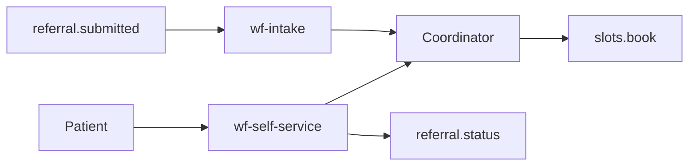

# Architecture

## Diagram

The coordinator is the human step. A return and a booking wait there.

## Zones

- zone-hospital
- zone-private
- zone-public

## Tools

referral.status, referral.return, slots.offer, slots.book, sms.send, safety.redirect
