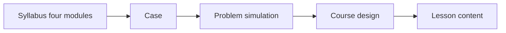

# Version 02 — Four modules

The FDE case in this folder is one engagement. Participants design, build, deploy, and harden an AI assistant for a fictional Saudi health cluster. They do it in four modules and twenty lessons, at their own pace. The topic list is the [FDE Program Syllabus](<FDE Program Syllabus.md>). This folder is the base those lessons are written from: the case, the system, the simulated world, and the course design. A release id such as `rel-m03-l01` is the pack name the checks use. It is not a timetable.

Nothing here is a real patient's record, a real facility, or a protocol for care. Laws that appear in the case are fictional analogues. A mapping for facilitators sits in [problem_simulation/README.md](problem_simulation/README.md).

Participants working alone should open [learning/README.md](learning/README.md) once, then start at [Module 1 Lesson 1](<Module 01/Lesson 01/Student_Copy/README.md>). That guide says how a lesson is shaped. It does not replace the chapters. Leave [instructional/](instructional/README.md) closed while you do a lesson. It is an author record, in the same sense as `course_design/`.

## Who may open what

| Path | Who | What it is |
|---|---|---|
| [FDE Program Syllabus](<FDE Program Syllabus.md>) | Everyone | The accepted program |
| [case](case/README.md) | Participants and facilitators | The client, the ask, the constraints, and the words |
| [problem_simulation](problem_simulation/README.md) | Facilitators | The hidden world, the reference system, the data, the services, and the gold |
| [course_design](course_design/README.md) | Facilitators | The module maps, roles, assessment, and the course environment |
| [learning](learning/README.md) | Participants | How to move through the four modules alone |
| [instructional](instructional/README.md) | Authors | The curriculum map and the edit record. Participants leave this closed |

Module 1, Lesson 1 is the [student copy](<Module 01/Lesson 01/Student_Copy/README.md>). Later lessons use the case and the packs under `data/`. Participants work from `case/`, from the lesson folders under `Module 01` through `Module 04`, and from the packs in `data/rel-m01-l01` through `data/rel-m04-l05`. They leave `course_design/`, `instructional/`, `problem_simulation/design`, and `problem_simulation/build` closed. Opening the design skips the discovery the course is built to teach.

## Read in this order

Participants:

1. This page.
2. [The course guide](learning/README.md). It is the module list. Finish one lesson before you open the next.
3. [Module 1 Lesson 1 student copy](<Module 01/Lesson 01/Student_Copy/README.md>). Read [00 — Background](<Module 01/Lesson 01/Student_Copy/00-background.md>) first, then the chapters in order. That folder is release `rel-m01-l01`. It has the client, the words, and the files for the morning session of lesson 1. The full [case](case/README.md) and [word list](case/access_language.md) are there when a later release uses a word this folder does not define.

The finish chapter of each release names the next folder. Do not skip ahead of that chapter.

Facilitators, after the case:

1. [Simulation index](problem_simulation/README.md).
2. The design notes in order, `01` through `12`, then [traceability](problem_simulation/design/traceability/README.md).
3. [Course design](course_design/README.md), then the module day maps.

## The four parts



| Part | Question it answers |
|---|---|
| Case | Who the client is, what they asked for, and what the team is allowed to do |
| Problem simulation | What is true in the world, what the team can see, and how work is graded |
| Reference system | One architecture that can carry every topic, held back so teams can design their own |
| Course design | What each lesson, role, and grade uses from that world |

The reference system is facilitator material. Teams publish their own architecture. Checks grade outcomes through a fixed assistant contract, so a different stack can pass.

## What is already fixed

- The client is the Al-Waha Health Cluster, and the service is patient access: referrals, appointments, reminders, and the contact center.
- The assistant handles operations. A clinician assigns every clinical urgency. The assistant routes emergency wording to a human.
- The cluster runs hospital data centers, a private cloud on two sites, and one external model for public content.
- The engagement inside the case opens on 10 January 2027, a few weeks before Ramadan.
- Teams of five rotate the Real Client Project roles. Each team has its own world. Each participant has a small personal world for individual labs.

Stable names (facilities, personas, systems, releases, checks) are defined in the design notes. Later lessons should cite those names, and should cite counts only as something the team measured.

## What this folder contains

Twenty lessons are in place. They open [Module 1 Lesson 1](<Module 01/Lesson 01/Student_Copy/home.md>) through [Module 4 Lesson 5](<Module 04/Lesson 05/Student_Copy/home.md>). The practice packs are under `data/rel-m01-l01` through `data/rel-m04-l05`.

The world behind those lessons is built from `problem_simulation`:

```text
python -m alwaha.worldbuild --profile practice
python -m alwaha.serve --profile small --port 8080
python -m reference.server --port 8081
python -m alwaha.audit --profile practice --score
```

`worldbuild` writes the population, the hospital exports, and the corpus under `problem_simulation/build/<profile>/world`. That folder stays closed. `assessment` is never written under `data/`. The laptop stack is [problem_simulation/host/compose.yaml](problem_simulation/host/compose.yaml). A person who has not seen the generator still has to walk one lesson; the steps are in [problem_simulation/audit/tester.md](problem_simulation/audit/tester.md).

The Real Client Project, after these four modules, is a real client. This case supplies the rehearsal only. The optional admissions prep course is out of scope; the `small` world profile is reserved for it.
