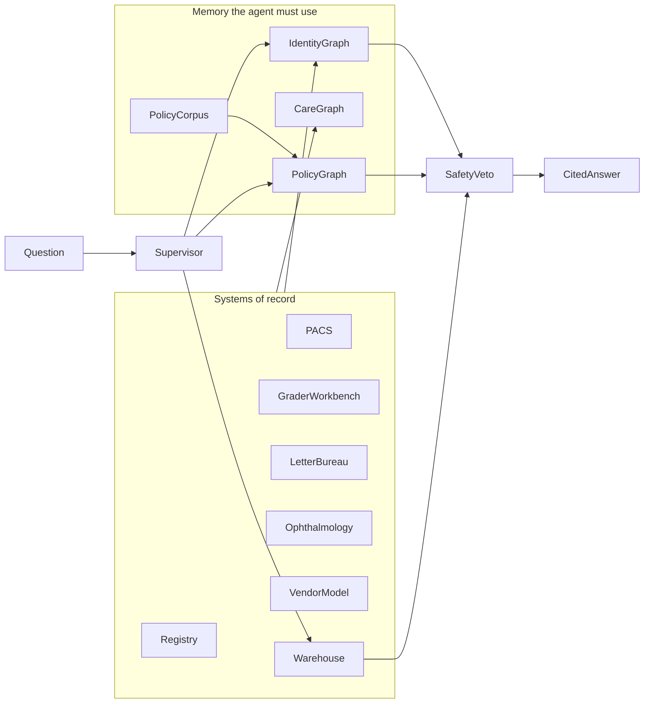

# Version 02

Advanced track for engineers who already ship. Same client as [Version 01](../Version%2001/README.md): Hartland Regional Health Authority, diabetic eye screening. This file is the design. The generator, indexes, graphs, and agent are not built yet.

Version 01 is the self-paced introduction. It is shared onboarding, and it is not a gate. A staff engineer who already has the consulting instincts can start here.

## Why Version 01 stops where it does

The case already has messy rows: reused registry numbers, blank grades, a cover note that disagrees with the issued procedure. A senior engineer can still hold the whole system in one afternoon.

- The agent in [loop.py](<../Version 01/Module 04 - The agent/screening_agent/loop.py>) stops at four steps and copies the tool result into the answer.
- Retrieval in [retrieve.py](<../Version 01/Module 03 - Retrieval/screening_retrieval/retrieve.py>) is token overlap over seven short markdown files, with a hardcoded branch for the 14-day draft.
- The catalog in [catalog.py](<../Version 01/Module 04 - The agent/screening_agent/catalog.py>) is eight functions. One call answers every graded question.
- [config.yaml](../Version%2001/problem_simulation/config.yaml) generates a large registry, then flattens it into CSVs and one workbook. A count does not depend on a second system, a policy version, or an identity hop.

Version 02 keeps that authority and that programme. Breast screening and river outreach stay later slices inside Hartland, which is what [Module 08](<../Version 01/Module 08 - Capstone/README.md>) already prepared.

## Who it is for

Senior working engineers: machine learning specialists, data engineers, software engineers, and solution architects who already put services in production. They can read an architecture diagram, write an architecture decision record, and use embeddings in a real system.

The six-week outcomes stay, at this depth:

- Business and AI opportunity discovery
- Enterprise AI and data
- AI solution development
- AI architecture and governance
- Product and project delivery, from prototype to production
- Consulting and stakeholder decisions
- One client engagement, practiced end to end

Participants build and defend the systems. Version 01's habit of studying a finished reference and restating it stops here.

## The rule that keeps the data honest

A technique earns its place when the simpler method loses on a published eval slice.

- Keyword overlap loses to metadata-aware retrieval.
- A single vector search loses to graph-constrained retrieval.
- One tool loop loses to a stateful graph with a safety veto.
- An architecture diagram that ignores trust zones fails review against the generated contracts.

Each week publishes the baseline and the score the advanced design has to beat. Hidden truth stays closed, as it does in Version 01. Gold includes the citation: document id, version, status, effective interval, and site. For agents, gold also includes the trajectory: nodes, tools, and whether the veto fired.

A live model is optional. Scripted and recorded trajectories keep the checks deterministic. A live OpenAI-compatible model can replace the script, the way Version 01 already allows.

Scale stays local: on the order of the current registry, extended over more years and more sites. The hardness is structural. Same seed discipline as [problem_simulation](../Version%2001/problem_simulation/README.md): fictional people, no photographs, no care protocol.

## Five surfaces

A question is correct only when these surfaces agree. The generator emits all five from one seed.

### Identity graph

Registry number, local screening id, a hospital MRN per site, and a national id that is often missing or provisional. Edges carry source, confidence, and the dates they are valid. Numbers are reused. Merges and splits exist.

"How many people" is wrong if the count is a count of rows. A chunk search cannot answer "is this PACS study the same person as this grader row?"

### Policy corpus

Hundreds to a few thousand documents:

- national procedure versions, each with an effective date and a sunset date
- site adaptations that cite, narrow, or contradict the national text
- data-protection decisions, DPIA excerpts, retention schedules
- circulars, incident notices, and board minutes that change what is in force
- letter templates by site and year
- vendor contracts: where a model may run, and which facts it must not own

Near-duplicates and light OCR noise are part of the drop. The 14-day pathway is a national draft and, separately, adopted policy at two named sites. The right clause often uses different words from the question. A chunk that lacks status, version, site, and effective dates is a wrong answer.

### Care-path graph

Events over years, not one workbook tab:

- eligibility changes
- capture, from hospital PACS, a clinic shared folder, an outreach laptop, or a vendor cloud
- grade, second grade, and adjudication
- letter dispatched, returned, or suppressed
- referral created, booked, seen, or still unseen
- did-not-attend, and the recall interval that applied

Site and date pick the policy node. The question that defines this surface: which people are beyond the pathway that applied at their clinic on the day of the photo, and is the delay a grader backlog or a letter-bureau failure?

### System landscape

Named systems of record, each with a trust zone and an awkward interface.

- National registry: nightly batch, schema versions, late death and move flags
- Hospital PACS: image metadata, MRN rather than registry id
- Primary care share: filenames and sidecars, decoys, no MRN
- Grader workbench: export plus an event log, urgency often only in free text
- Letter bureau: API and files, delays and duplicates
- Ophthalmology: messages where booked and seen are often empty
- Vendor model: an API contract and a score file
- Authority warehouse: SQL whose eligibility definition is stale

The signed grader code is the system of record for a result. The vendor score is a separate fact. Image bytes stay off the model path.

### Eval set

Questions tagged by the surface they require. Baselines checked in beside them: keyword retrieval, naive vectors, single-hop SQL, and a single-loop agent. Gold trajectories and gold citations sit with the questions. Participants leave the hidden truth closed while they work.

## What each technique is for

### Retrieval

Hybrid search over the policy corpus. Filters are status, site, effective interval, and programme. Chunking has to survive near-duplicates, and a clause that only makes sense because it cites another document.

The eval slice:

- lexical overlap prefers the national draft
- a naive vector index prefers a superseded national paragraph
- the accepted answer cites the clause that applied to that site on that date

### Graph retrieval

Two graphs, queried on purpose.

The policy graph edges are `supersedes`, `cites`, `applies_to`, and `constrains`. A constraint comes from a data-protection decision or a vendor contract. The care graph nodes are person, identifier, encounter, document, and site. Graph-constrained retrieval walks from a person to the rule that bound their clinic.

The eval slice:

- vector retrieval returns a plausible procedure and the wrong cohort
- SQL returns a cohort under today's national rule and misses the two sites that adopted the 14-day pathway

### LangGraph

Workflows that branch, stop, and resume.

- Backlog triage: classify the question, resolve identity, retrieve the policy for that site and date, run the metric, pass a safety node, answer with evidence.
- Ambiguous identity stops the run. A request to grade a retina is refused. Evidence that exists only in a draft cannot be stated as current national policy.
- A safety-reviewer agent can veto. Letter recommendations are checkpointed so a retry does not issue the same recommendation twice.
- While `clinical_safety_owner` is unassigned, the graph interrupts and the transition that would start the pilot is illegal. Version 01 states that in the handoff. Version 02 makes the workflow refuse the transition.

### Solution architecture

Engineers produce a context diagram, one sequence for triage, an architecture decision record for each trust-zone choice, and a data-flow note for what may leave the authority network.

The generated contracts are the marking guide. Vendor scores stay a separate fact from the signed grade. Image bytes stay off the model path. The warehouse eligibility flag is a known stale definition. The [Version 01 container](<../Version 01/Dockerfile>) is the prototype. The work here is the production path out of that prototype. The pilot stays stopped until a clinical safety owner is named.

## Six-week arc

Each week ships a small module and an eval. Files stay short. When the build starts, the generator, graphs, retrieval, orchestration, and architecture notes live in separate packages under `Version 02`.

### Week 1 — Opportunity and landscape

Reconstruct the systems of record from the drop. Write the brief. Autonomous grading and an unsigned referral are out of scope. This week is business and AI opportunity discovery, and the first cut for the two readers: the Chief Digital Officer and the ophthalmology lead.

### Week 2 — Enterprise data

Identity resolution and a warehouse model with data contracts. Precision and recall against hidden truth. This week is enterprise AI and data.

### Week 3 — Retrieval

Index the corpus. Beat the keyword baseline and the naive-vector baseline on the policy slice. This week is the first half of solution development.

### Week 4 — Graph retrieval

Policy graph plus care-path graph. Beat chunk retrieval on the multi-hop cohort questions. This week is the second half of solution development.

### Week 5 — Orchestration

LangGraph triage with a veto, a checkpoint, and trajectory scoring. This week is the agent and its evaluation, at production depth.

### Week 6 — Architecture, governance, handoff

Architecture decision records, trust zones, and the plan from the Version 01 prototype to production. One page for the executive reader, one page for the clinical lead. The owner can still stop the pilot. Capstone asks — a second programme, or a cutover — have to be answerable from the generated constraints. This week is architecture and governance, delivery, consulting, and the close of the engagement.

## When the build starts

Leave [Version 01](../Version%2001/README.md) frozen, apart from the banner that points at the program map. The new work is a seeded generator that emits the five surfaces, then the weekly packages and their evals. A week is finished when its baseline loses on the published slice and the advanced design records the citation, or the trajectory, that the gold file expects.
