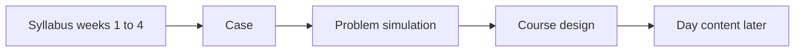

# Version 02 — Weeks 1 to 4

Weeks 1 to 4 of the FDE program are one engagement. Participants design, build, deploy, and harden an AI assistant for a fictional Saudi health cluster. The topic list is the [FDE Program Syllabus](<FDE Program Syllabus.md>). This folder is the base those days are written from: the case, the system, the simulated world, and the course design.

Nothing here is a real patient's record, a real facility, or a protocol for care. Laws that appear in the case are fictional analogues. A mapping for facilitators sits in [problem_simulation/README.md](problem_simulation/README.md).

## Who may open what

| Path | Who | What it is |
|---|---|---|
| [FDE Program Syllabus](<FDE Program Syllabus.md>) | Everyone | The accepted program |
| [case](case/README.md) | Participants and facilitators | The client, the ask, the constraints, and the words |
| [problem_simulation](problem_simulation/README.md) | Facilitators | The hidden world, the reference system, the data, the services, and the gold |
| [course_design](course_design/README.md) | Facilitators | The day maps, roles, assessment, and the course environment |

Participants work from `case/`, from [Week 1, Day 1](<Week 01/Day 01/README.md>), [Week 1, Day 2](<Week 01/Day 02/README.md>), [Week 1, Day 3](<Week 01/Day 03/README.md>), [Week 1, Day 4](<Week 01/Day 04/README.md>), [Week 1, Day 5](<Week 01/Day 05/README.md>), [Week 2, Day 1](<Week 02/Day 01/README.md>), [Week 2, Day 2](<Week 02/Day 02/README.md>), [Week 2, Day 3](<Week 02/Day 03/README.md>), [Week 2, Day 4](<Week 02/Day 04/README.md>), [Week 2, Day 5](<Week 02/Day 05/README.md>), [Week 3, Day 1](<Week 03/Day 01/README.md>), [Week 3, Day 2](<Week 03/Day 02/README.md>), [Week 3, Day 3](<Week 03/Day 03/README.md>), [Week 3, Day 4](<Week 03/Day 04/README.md>), [Week 3, Day 5](<Week 03/Day 05/README.md>), [Week 4, Day 1](<Week 04/Day 01/README.md>), [Week 4, Day 2](<Week 04/Day 02/README.md>), [Week 4, Day 3](<Week 04/Day 03/README.md>), and [Week 4, Day 4](<Week 04/Day 04/README.md>), and [Week 4, Day 5](<Week 04/Day 05/README.md>), and from the packs in `data/rel-w1d1`, `data/rel-w1d2`, `data/rel-w1d3`, `data/rel-w1d4`, `data/rel-w1d5`, `data/rel-w2d1`, `data/rel-w2d2`, `data/rel-w2d3`, `data/rel-w2d4`, `data/rel-w2d5`, `data/rel-w3d1`, `data/rel-w3d2`, `data/rel-w3d3`, `data/rel-w3d4`, `data/rel-w3d5`, `data/rel-w4d1`, `data/rel-w4d2`, `data/rel-w4d3`, `data/rel-w4d4`, and `data/rel-w4d5`. They leave `course_design/`, `problem_simulation/design`, and `problem_simulation/build` closed. Opening the design skips the discovery the course is built to teach.

## Read in this order

Participants:

1. This page.
2. [The case](case/README.md).
3. [Access language](case/access_language.md), before opening a data file.
4. [Week 1, Day 1](<Week 01/Day 01/README.md>).
5. [Week 1, Day 2](<Week 01/Day 02/README.md>).
6. [Week 1, Day 3](<Week 01/Day 03/README.md>).
7. [Week 1, Day 4](<Week 01/Day 04/README.md>).
8. [Week 1, Day 5](<Week 01/Day 05/README.md>).
9. [Week 2, Day 1](<Week 02/Day 01/README.md>).
10. [Week 2, Day 2](<Week 02/Day 02/README.md>).
11. [Week 2, Day 3](<Week 02/Day 03/README.md>).
12. [Week 2, Day 4](<Week 02/Day 04/README.md>).
13. [Week 2, Day 5](<Week 02/Day 05/README.md>).
14. [Week 3, Day 1](<Week 03/Day 01/README.md>).
15. [Week 3, Day 2](<Week 03/Day 02/README.md>).
16. [Week 3, Day 3](<Week 03/Day 03/README.md>).
17. [Week 3, Day 4](<Week 03/Day 04/README.md>).
18. [Week 3, Day 5](<Week 03/Day 05/README.md>).
19. [Week 4, Day 1](<Week 04/Day 01/README.md>).
20. [Week 4, Day 2](<Week 04/Day 02/README.md>).
21. [Week 4, Day 3](<Week 04/Day 03/README.md>).
22. [Week 4, Day 4](<Week 04/Day 04/README.md>).
23. [Week 4, Day 5](<Week 04/Day 05/README.md>).

Facilitators, after the case:

1. [Simulation index](problem_simulation/README.md).
2. The design notes in order, `01` through `12`, then [traceability](problem_simulation/design/traceability/README.md).
3. [Course design](course_design/README.md), then the week day maps.

## The four parts

| Part | Question it answers |
|---|---|
| Case | Who the client is, what they asked for, and what the team is allowed to do |
| Problem simulation | What is true in the world, what the team can see, and how work is graded |
| Reference system | One architecture that can carry every topic, held back so teams can design their own |
| Course design | What each day, role, and grade uses from that world |

The reference system is facilitator material. Teams publish their own architecture. Checks grade outcomes through a fixed assistant contract, so a different stack can pass.

## What is already fixed

- The client is the Al-Waha Health Cluster, and the service is patient access: referrals, appointments, reminders, and the contact center.
- The assistant handles operations. A clinician assigns every clinical urgency. The assistant routes emergency wording to a human.
- The cluster runs hospital data centers, a private cloud on two sites, and one external model for public content.
- The engagement inside the case opens on 10 January 2027, a few weeks before Ramadan.
- Teams of five rotate the Real Client Project roles. Each team has its own world. Each participant has a small personal world for individual labs.

Stable names (facilities, personas, systems, releases, checks) are defined in the design notes. Later lessons should cite those names, and should cite counts only as something the team measured.

## What this folder does not contain yet

Days 1 to 5 of Week 1 are in place. Week 2 Day 1 adds sign-in and the FHIR v2 notice. Week 2 Day 2 adds webhook intake, `wf-session-cancelled`, and the mart read. Week 2 Day 3 adds the receipt-timing change, the access clauses, and the usability scripts. Week 2 Day 4 adds `pol-deploy`, the prod credentials, and the private-cloud endpoint. Week 2 Day 5 adds `cr-ain` and the nightly file for `sched-ain`. Week 3 Day 1 adds the approved history, `ann-v2`, and the fidelity card. Week 3 Day 2 adds the signed ruling, the GPU quota, and `reg-models`. Week 3 Day 3 adds criteria v4 for three specialties and the document change feed. Week 3 Day 4 adds the hidden-test protocol, the judge-calibration subset, and the eye-screening campaign. Week 3 Day 5 adds the second measurement, the rehearsal requirements, and `steer-w3`. Week 4 Day 1 adds the attack window, the PHI-in-logs notice, and the first data-subject requests. Week 4 Day 2 adds the incident replay, the Ramadan-hours circular, and shadow-extract. Week 4 Day 3 adds the surge forecast, the external-token price change, and the referral batch. Week 4 Day 4 adds the site-a failover drill, the insure outage, and the rent-versus-buy note. Week 4 Day 5 adds the contact-center handoff, the warehouse feed, HR leave, and the rehearsal proposal. Still ahead are the population, the hospital systems, and the rest of the live services. [Generator build](problem_simulation/design/12-generator-build.md) sets that order.

Weeks 5 and 6, the Real Client Project, are a real client. This case supplies the rehearsal only. The optional admissions prep course is out of scope; the `small` world profile is reserved for it.
