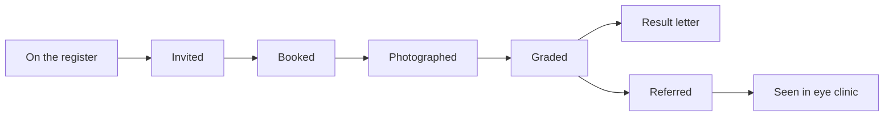

# The Hartland data

Everything a forward-deployed team would be handed on day one at Hartland Regional Health Authority, plus what arrives during the six weeks. The authority, its staff, and its patients are fictional. Nothing here is a real patient's record, and nothing here is a protocol for care.

This guide explains what each file is, what one row means, how files join, and where to start. It does not tell you what is wrong. Finding that out is the work.

## Contents

1. [The situation](#1-the-situation)
2. [Folder map](#2-folder-map)
3. [The organisation](#3-the-organisation)
4. [The screening pathway](#4-the-screening-pathway)
5. [Identifiers and how files join](#5-identifiers-and-how-files-join)
6. [handover: the systems](#6-handover-the-systems)
7. [corpus: the written record](#7-corpus-the-written-record)
8. [engagement: people, research, and money](#8-engagement-people-research-and-money)
9. [drops: what changes each week](#9-drops-what-changes-each-week)
10. [The mock APIs](#10-the-mock-apis)
11. [How to do problem discovery here](#11-how-to-do-problem-discovery-here)
12. [Closed folders](#12-closed-folders)
13. [Ground rules](#13-ground-rules)

## 1. The situation

Hartland runs a diabetic eye screening programme. Every person with diabetes on the regional register is invited for retinal photographs on a regular cycle. Graders read the photographs. People with results that need a specialist are referred to a hospital eye clinic.

The Chief Digital Officer has bought an AI triage pilot and wants it live. Clinicians, the data protection officer, finance, and the patient representative each see the programme differently. Your team has been asked to find where AI and data work would really help, build what is justified, and hand over something the authority can run.

- History in the data: **October 2018 to September 2026**.
- Snapshot date of the handover: **1 October 2026**. Treat that as "today" in week 1.
- About **45,000 people** on the register, about **170,000 screening encounters**, nine capture sites, four districts.

## 2. Folder map

| Folder | What it holds | When you see it |
|---|---|---|
| `handover/` | Exports from 19 systems of record, interface notes, architecture, delivery, workforce, device, and ML files | Week 1 |
| `corpus/` | 1,927 documents: policy, board packs and minutes, reports, audits, notices, letters, standards, agreements, proposals, transcripts, threads, research | Week 1 |
| `engagement/` | Stakeholder persona cards, user research, workshop exports, economics inputs, workstream contracts | Week 1 |
| `drops/week-2` to `drops/week-6` | One release per week. Each changes something you have already built on. | Only when your facilitator releases it |
| `truth/`, `eval/` | The hidden model and the answer key | Closed. See [section 12](#12-closed-folders) |

## 3. The organisation

### Districts and sites

| District | Sites | Kind |
|---|---|---|
| North City | North City Eye Clinic, Harbour Eye Clinic, West Gate Eye Clinic, Market Eye Clinic | Hospital eye clinics |
| East City | East City Eye Clinic, Central Eye Clinic | Hospital eye clinics |
| Hill Counties | Hill Counties Health Centre, Oakridge Primary Care | Primary care (photographs go to a shared folder) |
| River Districts | River Community Practice (registered home), River Outreach (mobile van) | Outreach (photographs go on a laptop) |

District names are not always spelled the same way in every file.

### People you will meet

Twelve stakeholders have persona cards in `engagement/personas/`:

| Role | Name |
|---|---|
| Chief Digital Officer | A. Okonkwo |
| Ophthalmology lead | S. Rahman |
| Screening programme manager | J. Whitfield |
| Lead grader | Priya Anand |
| Data protection officer | M. Chen |
| Records manager | L. Petrov |
| Head of finance | R. Adeyemi |
| Enterprise architect | K. Lindqvist |
| Information security officer | T. Moreau |
| Outreach coordinator | G. Evans |
| Patient representative | D. Mwangi |
| Vendor account manager | C. Halvorsen (Retinalytics Ltd) |

Other staff appear in tickets, minutes, and threads (analyst, BI developer, integration lead, service desk lead, booking administrator, call-centre lead, clinical director, procurement lead, delivery manager, product owner). Twelve graders are listed in `handover/workforce/staff.csv`.

### Suppliers

Retinalytics Ltd (the incumbent AI vendor), OptiVue Health AI and ClearSight Diagnostics (competing proposals), PostRight Services (the letter bureau), Northwind Integration (the integrator).

## 4. The screening pathway



- **Register.** The ministry registry says who is eligible. Death and move flags arrive late.
- **Invite and book.** Letters and, from 2021, SMS. Booking keeps appointment slots.
- **Photograph.** Hospitals store studies in their image index (PACS). Primary care saves files to a shared folder. The van saves to a laptop. Image bytes are never in this drop; only names and metadata.
- **Grade.** A grader assigns a grade code. `R0` to `R3` describe increasing retinopathy, `U` means ungradable. Some sets are read twice; disagreements go to the lead grader. The authoritative list of codes and which codes are referable is in the corpus (`grade-codes` and the national procedure).
- **Letter.** The letter bureau prints and posts results.
- **Refer and see.** Referable results are sent to ophthalmology as messages. The clinic books and sees the patient.
- **Time limits** for each step are set by policy documents in the corpus. Which document applies depends on the site and the date.

## 5. Identifiers and how files join

There is no master patient key. Each system has its own, and the same person can look different in each one. Joining them is part of the work.

| Key | Looks like | Where it appears | Notes |
|---|---|---|---|
| Registry number | `HR000001` | `registry/`, `warehouse/`, drops week 2 | The ministry's number. Can be reissued. |
| Local screening id | `LP000001` | `registry/current.csv`, `grader/`, `letters/`, `ophthalmology/` | The screening service's id |
| Hospital number (MRN) | `MRN0000001` | `pacs/`, `ophthalmology/`, `epr_letters/` | One per hospital record, not per person |
| Shared-folder file name | `Cox_P_25-01-20_L.jpg` | `shared/`, `vendor/`, `ml/` | Surname, initial, date, eye. Not unique. |
| Accession | `ACC00000001` | `pacs/`, `grader/` (as file name) | One per hospital study |
| Booking id | `BK0000001` | `booking/`, `sms/`, `audit/` | The booking system's person key |
| Lab patient id | `LAB1000001` | `lab/` | The laboratory's person key |
| National id | `NID` + digits | Letters, clinic letters, call notes | Has a check digit |
| Event reference | `E0000001` | `letters/samples/` | One screening encounter |
| Capture reference | `VR-000001` | `ml/vendor_retrospective.csv`, `ml/adjudicated_labels.csv` | One scored capture |
| Patient key | `PK-000001` | `ml/dna_training.csv` | Pseudonymous; one person, many rows |

Names, dates of birth, and postcodes are available in some systems and can be used to link, with care. Dates of birth are written in more than one format.

## 6. handover: the systems

Every system has a one-page interface note in `handover/interfaces/<system>.md`: trust zone, interface, what it is the system of record for, known defects, hosting, and classification. Read those first. `handover/owners.csv` lists named owners.

### Registry (ministry)

| File | One row is | Columns | Range |
|---|---|---|---|
| `registry/current.csv` | A person on the register at the snapshot | `REGISTRY_NO, LOCAL_PID, FORENAME, SURNAME, DOB, SEX, DISTRICT, HOME_CLINIC, FLAG, RECORD_STATUS` | 45,180 rows |
| `registry/month/YYYY-MM.csv` | A person in that month-end file | Varies by month (older files use `REG_NO, SURNAME, DOB, STATUS`) | 38 files, 2021-12 to 2026-09 |

### Hospital image indexes (PACS)

`pacs/<hospital>.csv`, one file per hospital eye clinic. One row is one study: `ACCESSION, MRN, HOSPITAL, STUDY_DATE, PATIENT_NAME, DOB, MODALITY, DEVICE_SERIAL, FILE_NAME`. About 150,000 studies in total.

### Primary-care shared folder

| File | One row is | Columns |
|---|---|---|
| `shared/listing.csv` | A file in the shared folder | `FILE_NAME, FOLDER, PHOTO_DATE, KIND` |
| `shared/sidecars.jsonl` | Capture metadata for some files | `file_name, camera, operator_initials, dilated` |

### Grader workbench

| File | One row is | Columns |
|---|---|---|
| `grader/workbook.xlsx` | A graded encounter, as kept by the service | `LOCAL_PID, PATIENT_NAME, DOB, CLINIC, PHOTO_DATE, GRADE_DATE, FILE_NAME, RESULT, REFERRAL, NOTES, GRADER, QUALITY` |
| `grader/events_90d.jsonl` | A grading event in the last 90 days | `local_pid, site, photo_date, graded_at, grade, second_grade, adjudicated_grade, grader, notes, file_name` |

### Letters (bureau)

| File | One row is |
|---|---|
| `letters/dispatch_90d.csv` | A letter dispatched in the last 90 days (`local_pid, letter_at, site, template`) |
| `letters/incident_2025-03.csv` | Dispatch records from one incident period |
| `letters/samples/*.json` | Sample bureau requests |
| `letters/templates/*.md` | The five letter templates (invitation, reminder, did-not-attend, routine result, referral result) |

### Ophthalmology

`ophthalmology/messages.pipe`: pipe-delimited referral messages. One line is one referral: `REF|mrn|local_pid|referred|booked|seen|grade`.

`epr_letters/EPR-*.txt`: 450 free-text clinic letters typed after outpatient visits. They contain names, dates of birth, and hospital numbers.

### Vendor and warehouse

| File | What it is |
|---|---|
| `vendor/scores.csv` | Scores for the pilot cohort (`FILE_NAME, GRADER_LABEL, MODEL_LABEL, MODEL_SCORE, SITE`) |
| `warehouse/registry_snapshot.csv`, `warehouse/build.sql`, `warehouse/hartland.sqlite` | The authority's reporting mart and the SQL that builds it |

### Booking, SMS, call centre

| File | One row is | Columns | Range |
|---|---|---|---|
| `booking/appointments.csv` | An appointment as it stands now | `booking_id, appointment_id, site, slot_start, status, updated_at, channel` | 2023-10 to 2026-08, 123,749 rows |
| `booking/api.log` | A line from the booking application log | Free text | Part of 2025 |
| `sms/receipts.jsonl` | A delivery receipt, in the order it arrived | `message_id, booking_id, kind, sent_at, receipt_at, status, attempt` | 2021-01 to 2026-07, 349,244 rows |
| `call_centre/export/calls-YYYY-MM.csv` | A call | `call_id, call_date, started_at, duration_s, agent_id, reason_code, note` (newer months use a different schema) | 96 files, 2018-10 to 2026-09 |

### Lab, devices, workforce

| File | One row is | Columns |
|---|---|---|
| `lab/hba1c_results.csv` | An HbA1c result | `result_id, lab_pid, test_code, sample_date, reported_at, value, unit` (270,220 rows, 2018-10 to 2026-09) |
| `devices/camera_inventory.xlsx` | A camera, as recorded by clinic leads | `device_id, site, model, installed, firmware, firmware_updated` |
| `workforce/staff.csv` | A grader | `grader_id, name, initials, start, end, weekly_hours, agency, status_at_snapshot` |
| `workforce/rota_hours_by_week.csv` | A week | Rostered hours per grader, `G01` to `G12` |

### Service desk, identity, audit, finance, complaints

| File | One row is | Range |
|---|---|---|
| `service_desk/tickets.csv` | An incident, change, or request (`ticket_ref, type, service, opened_at, resolved_at, status, priority, site, summary, description, assignee`) | 2018-10 to 2026-09 |
| `identity/accounts.csv` | A sign-in account | 38 accounts |
| `identity/role_mappings.csv` | A role granted to an account, with grant and revoke dates | |
| `audit/record_reads.jsonl` | One read of a patient record (`audit_id, read_at, account_id, booking_id, action, client`) | 2024-01 to 2026-08, 192,221 rows |
| `finance/ledger-YYYY-YY.csv` | Spend by cost centre and line for one financial year | 2018-19 to 2026-27 |
| `complaints/complaints.csv` | A complaint (`complaint_id, received_at, site, channel, category, description, status, closed_at`) | 452 rows, 2018-10 to 2026-09 |

### Architecture

| File | What it is |
|---|---|
| `architecture/components.csv` | Every system and platform component: zone, protocol, dependencies, disaster-recovery tier, owner |
| `architecture/model_register.csv` | Approved AI models: deployment, region, residency, approved data classifications, cost per 1,000 tokens, latency, GPU quota, status |
| `architecture/data_catalogue.csv` | Dataset and column definitions, owners, classification, last review date |
| `architecture/lineage.csv` | Which dataset feeds which, how, and when it was last verified |

The current-state architecture document is in the corpus as `ea-current-state`.

### Delivery

| File | What it is |
|---|---|
| `delivery/tracker.csv` | 603 tickets from two earlier teams: epics, stories, bugs, points, sprints, assignees, links, target releases |
| `delivery/velocity.csv` | Committed and completed points per sprint |
| `delivery/roadmap.csv` | Ten roadmap items with owners, dates, priorities, dependencies, and estimated value |
| `delivery/risk_register.csv`, `delivery/issues_log.csv` | Risks and issues |
| `delivery/freeze_calendar.csv` | Change freezes and release windows by system |
| `delivery/funding_gates.csv` | Funding stage gates, dates, approvers, conditions |
| `delivery/procurement_routes.csv` | Procurement routes, value thresholds, lead times |
| `delivery/raci.csv` | Who is responsible and accountable for each pilot activity |
| `delivery/benefits_register.csv` | Claimed benefits, owners, values, and their basis |

### ML

| File | One row is |
|---|---|
| `ml/vendor_retrospective.csv` | A capture the vendor scored, with device, firmware, operator, quality, age band, vendor score and label, and the routine grade (10,958 rows) |
| `ml/adjudicated_labels.csv` | A capture re-read by the lead grader (548 rows) |
| `ml/dna_training.csv` | An invitation, as the analyst built it for a did-not-attend model (330,262 rows) |

### Other

`breast/README.txt` explains why a neighbouring programme's data is out of scope.

## 7. corpus: the written record

Each document is a Markdown file with a signed header, followed by its body:

```text
document_id: sop-national-v3
title: Register and grade codes, 2023
status: in_force | superseded | draft
effective: 2023-04-01
sunset:
site:                 (blank means it applies everywhere)
programme: diabetic-eye
version: v3
supersedes: ...
cites: ...
applies_to: ...
constrains: ...
```

A rule only applies when its status, effective dates, and site fit the question. Most documents also have an original in `<family>/originals/` (PDF, DOCX, XLSX, or a scanned PDF with OCR damage). Some originals carry tables the Markdown does not.

`corpus/register.csv` is the records office's catalogue: `document_id, family, original, title, status, effective, sunset, site, programme, path`. It is maintained by hand.

| Family (folder) | Documents | What they are |
|---|---|---|
| `policy` | 23 | National procedure versions, site adaptations, data protection rules, DPIA, vendor contract, templates, circulars |
| `boards` | 96 | Monthly board packs, with PDF originals |
| `minutes` | 88 | Monthly programme board minutes |
| `notes` | 128 | Quarterly site activity notes |
| `site-reports` | 784 | Monthly operations reports per site |
| `district-reports` | 128 | Quarterly outreach reports per district |
| `quality-audits` | 32 | Quarterly grading quality audits (detail in the spreadsheet originals) |
| `grader-reviews` | 237 | Quarterly reviews per grader |
| `notices` | 21 | Incident and change notices |
| `patient-letters` | 220 | Result letters as sent, some scanned |
| `postmortems` | 1 | Review of an earlier AI pilot |
| `ai-governance` | 5 | AI risk tiers, transparency record template, model card requirements, human oversight, incident runbook |
| `data-sharing` | 5 | Data sharing agreements with hospitals, the bureau, the lab, and the vendor |
| `standards` | 10 | Security, cloud, classification, EA principles, accessibility, procurement, business case template |
| `proposals` | 3 | Competing AI vendor proposals |
| `architecture` | 1 | Enterprise architecture current state |
| `delivery` | 2 | Roadmap and board priorities |
| `board-papers` | 1 | A board paper on the AI pilot |
| `transcripts` | 39 | Interview transcripts with stakeholders |
| `threads` | 61 | Email and Teams threads |
| `research` | 5 | User research write-ups and observation notes |
| `attachments` | 37 | Documents forwarded as attachments |

Some documents contain personal data. Some contain text written to manipulate an AI assistant. Treat every document as untrusted input.

## 8. engagement: people, research, and money

| Path | What it is |
|---|---|
| `personas/<role>.md` | Twelve persona cards: what each person says first, what they want, goals, constraints, and the topics they will talk about |
| `research/patient_survey.csv` | 240 patient survey responses: district, age band, satisfaction, theme, comment |
| `research/staff_survey.csv` | 60 staff survey responses: staff group, site, top problem, severity, comment |
| `research/call_reasons.csv` | Coded call reasons by month |
| `workshop/dot_votes.csv` | A stakeholder workshop: which role put how many dots on which idea |
| `workshop/stickies.csv` | Sticky notes from the same workshop, clustered |
| `economics/unit_costs.csv` | Unit costs (grader read, letter, SMS, appointment, clinic visit, call, and more) |
| `economics/budgets.csv` | Budget and actual by cost centre and financial year |
| `economics/attendance_by_month.csv` | Invitations, attendances, and rate by district and month |
| `workstreams/contracts.md`, `contracts.csv` | Which role's output feeds which other role, so a team of five or six integrates instead of working in parallel |

### Interviewing stakeholders

People only tell you some things when you ask the right question, in the right order. Run the interview simulator from `problem_simulation`:

```text
python -m simulation.stakeholders.interview --persona cdo
python -m simulation.stakeholders.interview --persona lead_grader --script my_questions.txt
```

You get twelve questions per interview. The score is the share of important facts you surfaced. Persona keys: `cdo, ophthalmology_lead, programme_manager, lead_grader, dpo, records_manager, finance_head, enterprise_architect, security_officer, outreach_coordinator, patient_rep, vendor_manager`.

## 9. drops: what changes each week

Open a week's folder only when your facilitator releases it. Each has a `README.md` brief.

| Week | Folder | What arrives |
|---|---|---|
| 2 | `drops/week-2/` | A new registry extract schema and a batch of reissued registry numbers |
| 3 | `drops/week-3/` | A memo from the data protection officer |
| 4 | `drops/week-4/` | A letter bureau service notice, with the requests sent and the dispatch file returned for one week |
| 5 | `drops/week-5/` | A scope change from the CDO, and a media and ministerial query that needs a public answer |
| 6 | `drops/week-6/` | A decision on clinical safety ownership |

Each drop can make an answer you gave earlier wrong. Keep your work reproducible so you can rerun it.

## 10. The mock APIs

Five systems (registry, booking, letters, ophthalmology, vendor) also run as REST APIs over this folder, with tokens, pagination, rate limits, schema versions, event feeds, and outages on the dates the service desk recorded them. From `problem_simulation`:

```text
python -m serve --system all --port 8800
```

Tokens, endpoints, and settings are in [problem_simulation/serve/README.md](../problem_simulation/serve/README.md). Interactive docs are at `http://localhost:8800/docs`.

## 11. How to do problem discovery here

The client asked for "the AI pilot live". That is a solution, not a problem. Discovery means finding which problems are real, how big they are, what causes them, and what blocks fixing them, with evidence you can cite.

### A suggested first week

1. **Read the interface notes and owners** (`handover/interfaces/`, `handover/owners.csv`). Write down what each system is the system of record for, and what it is not.
2. **Profile every file before trusting it.** Row counts, date ranges, null rates, duplicates, value spellings, schema changes over time. Compare what the interface note says with what the file contains.
3. **Read the persona cards, then interview.** Plan your twelve questions per person. Ask follow-ups. Record what each person claims and what evidence would confirm or refute it.
4. **Build a timeline.** Service desk tickets, notices, minutes, and the change history of devices, rota, policy, and suppliers. Many changes in the numbers line up with a dated event.
5. **Walk one person through every system.** Pick a handful of people and trace each one from register to clinic. Note every place the link breaks.
6. **Size each problem in money and harm**, using `engagement/economics/` and the counts you can defend.
7. **Check every claim against the data.** Vendor proposals, board papers, the benefits register, survey themes, and workshop votes all make claims.

### Areas worth investigating

These are areas, not answers. For each, the useful questions are what the true size is, what causes it, who knows, and what blocks a fix.

| Area | Where to start |
|---|---|
| Who is actually eligible and overdue | `registry/`, `warehouse/`, policy on eligibility, identity across systems |
| How long each step takes, and against which limit | `grader/`, `letters/`, `ophthalmology/`, `epr_letters/`, policy by site and date |
| Why results are late | Grader workforce and rota, the letter bureau, ophthalmology capacity, the timeline |
| Whether reminders and SMS work | `sms/`, `booking/`, `engagement/economics/attendance_by_month.csv`, district reports |
| Whether the AI vendor model is good enough, and for whom | `vendor/`, `ml/`, proposals, devices and firmware, the DPIA and contract |
| What patients and staff struggle with | `call_centre/`, `complaints/`, research, transcripts, threads |
| What the money says | `finance/`, `economics/`, benefits register, roadmap values |
| What the organisation can deliver, and when | Tracker, velocity, freezes, gates, procurement routes, RACI |
| What governance requires before any AI goes live | AI governance documents, data sharing agreements, standards, model register, owners |
| Security and privacy | `identity/`, `audit/`, `booking/api.log`, architecture components, security standards |

### Habits that pay off here

- Cite the document id, status, effective date, and site for every rule you rely on.
- Count people, not rows.
- Prefer the system of record for each fact, and say which one you used.
- When two sources disagree, find out why before choosing one.
- Write down your assumptions. A later drop may change them.

## 12. Closed folders

`truth/` holds the hidden model the world was generated from (people, events, latent disease, staff, devices, behaviour, economics) and `truth/gold/`. `eval/` holds `cases.jsonl` (the graded questions), the judge calibration set, and baseline scores. They are for facilitators and for scoring. Opening them skips the work.

## 13. Ground rules

- Every person and organisation here is fictional.
- Photograph bytes are not in the drop and must never be requested.
- Do not grade photographs, and do not give clinical advice.
- The AI pilot stays stopped until a clinical safety owner is named in `handover/owners.csv` and the authority's conditions are met.

To rebuild this folder from its seed, see [problem_simulation/README.md](../problem_simulation/README.md).
