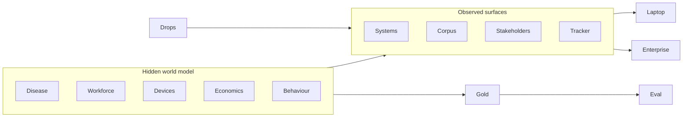
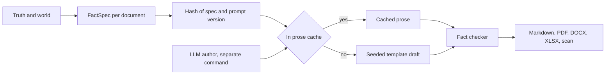
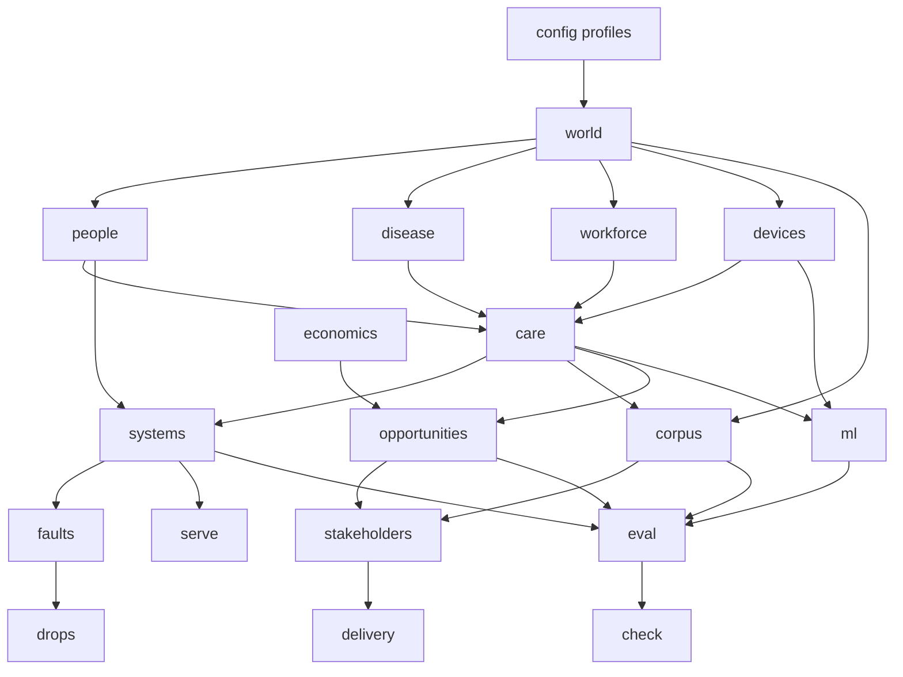

# Version 02

Advanced track for engineers who already ship. Same client as [Version 01](../../Version%2001/README.md): Hartland Regional Health Authority, diabetic eye screening. Same programme, much deeper world.

The first deliverable is the simulation. Every module, eval, and capstone ask in Version 02 is only as hard as the data behind it, so the data is designed first and the weekly modules are built on top of it.

Version 01 is the self-paced introduction. It is shared onboarding, and it is not a gate.

## Purpose and outcomes

The programme does not produce a specialist in every discipline in six weeks. It produces implementation-oriented professionals with enough breadth, judgment, and delivery experience to lead or support enterprise AI work in government, from problem discovery to executive presentation.

Each outcome needs evidence in the data. A participant cannot learn to prioritise opportunities if the drop holds only one, or to challenge a vendor if the vendor's claims cannot be checked.

1. **Business and AI opportunity discovery.** Identify business problems, evaluate AI opportunities, and prioritise high-impact use cases.
2. **Enterprise AI and data.** Understand enterprise data and AI technologies, and select the right approach.
3. **AI solution development.** Build proofs of concept, integrate enterprise systems, and deploy AI applications.
4. **AI architecture and governance.** Design secure, scalable, and responsible enterprise AI solutions.
5. **Product and project delivery.** Define requirements, run agile delivery, and plan the path from prototype to production.
6. **Consulting and stakeholder management.** Facilitate discovery, communicate with stakeholders, and present executive recommendations.
7. **Forward deployed engineering practice.** Deliver one client engagement end to end, as a multidisciplinary team.

## Who it is for

Government professionals who contribute, or will contribute, to AI, data, digital, product, or operational improvement work:

- AI and machine learning specialists
- data scientists and data engineers
- software engineers
- solution and enterprise architects
- technical product managers
- technology consultants

Cohorts are mixed. A team of five or six combines technical, product, business, and architecture profiles.

The standard: a staff engineer in any of those profiles should find their part of the drop hard. It should be hard because of how the world is structured, not because the files are large.

## Current state and gap

Milestones 1 to 10 are built (October 2026). [problem_simulation](README.md) writes one seeded world per profile to [data](../data/README.md):

- **Hidden world.** About 45,000 people in the practice profile, with identity defects (aliases, false and reversed merges, splits, reused numbers, twins, households, silent movers). Latent per-eye disease driven by HbA1c, twelve named graders with bias, drift, and a rota change, cameras with firmware shifts, an attendance model with a hidden reminder effect, a letter bureau migration, and a consultant gap.
- **Systems.** Nineteen systems of record in `handover/`, each with an interface note and planted defects, a fault library, an EA current state with a component list, a model register, and a data catalogue with lineage.
- **Corpus.** 1,927 documents on the practice profile, most in Markdown plus a PDF, DOCX, XLSX, or scan (1,639 originals). Prose is LLM-written once, fact-checked against its spec, and committed in `simulation/prose/cache`. Planted: table-only facts, scanned minutes that hold what the post-mortem omits, a subgroup-only vendor claim, prompt injections, PII spans, a DSA that conflicts with the DPIA, near-duplicates, stale register statuses.
- **People and value.** Twelve personas with hidden facts and question trees, a scored interview simulator, transcripts, threads, a board paper, user research, a workshop export, eight opportunity value models, and the reminder baseline trap.
- **ML evidence.** A vendor retrospective set with true operating points by subgroup, adjudicated labels, a did-not-attend table with a leaky feature, numpy baselines, and a 200-answer judge calibration set.
- **Delivery and drops.** A 600-ticket tracker, roadmap, risks, freezes, RACI without a safety owner, gates, procurement routes, a benefits double count, an inaccessible letter template, workstream contracts, and drops for weeks 2 to 6 (week 5 carries the press query).
- **Mock APIs** in `serve/`: five systems with auth, pagination, rate limits, schema versions, late and duplicate events, outages from the timeline, and a PII-leaking log.
- **Eval.** 292 tagged cases with budgets and written-work fact lists, a scorer, and four baselines. On both the practice and assessment seeds the best baseline for each role passes at most 17%, while an oracle built from gold passes at least 98% (`python -m simulation.audit`).

What is still open:

| Item | Status |
|---|---|
| Human dry run | Protocol in `simulation/audit/DRY_RUN.md`. Not yet run; needs two or three experienced engineers who have not seen the generator. |
| LLM prose for the assessment and team seeds | The practice seed is authored. Other seeds use the fact-checked template drafts until `python -m simulation.prose author --profile <name>` is run. |
| Docker profile | `serve/docker-compose.yml` is written; it has not been built in this environment. |

## Simulation principles

Kept from the first design:

- **One seed.** One seed writes every surface. A second build with the same seed matches.
- **Closed truth.** `data/truth` and `data/eval` stay closed while a participant works. Opening them skips the work.
- **A technique earns its place.** A method is taught only when a simpler method loses on a published eval slice.
- **Fictional and safe.** Fictional people, no photographs, no care protocol. Image files are names only.

Added for Version 02:

- **Two seeds.** A `practice` seed is published. A held-out `assessment` seed builds a world with the same structure but different sites, dates, counts, and planted defects. An answer that was memorised, or a rule hardcoded to a site name, fails on the assessment seed.
- **Weekly drops.** The world changes during the engagement. New files arrive, earlier facts are revised, and a decision taken in week 2 can be wrong by week 4. Drops are written by the same seed, so they are reproducible.
- **Hidden mechanisms.** Truth holds causes: true disease state, grader skill, device behaviour, capacity, and cost. The handover holds only what the authority's systems would observe. Gold answers are computed from causes, so a participant who models the observation process correctly wins.
- **Every role gets a hard problem.** Each participant profile has at least one problem in the data that a strong generalist gets wrong. It comes from the data, not from a prompt.
- **Disagreement is planted on purpose.** Two sources that disagree have one cause in truth. The cause is findable from the drop.
- **Small modules.** One module per system, document family, persona, and fault type. No file over about 200 lines.

## The hidden world model

These layers live in truth and generate everything else. A participant never sees them directly.

### Latent disease

Each eye has a retinopathy and maculopathy state that progresses over the eight years. Progression depends on diabetes type, duration, HbA1c trajectory, and age. Grades are noisy observations of that state, filtered through image quality and the grader who read them. Adjudication is the strongest label available in the drop, and it is still not the truth.

This makes it possible to measure missed disease, harm from delay, and whether a vendor model or a grader is right, instead of only measuring agreement.

### Workforce

- Named graders, each with sensitivity, specificity, a fatigue curve over a session, and drift over years. Two graders are much stricter than the rest. One gets worse after a change of rota.
- Grader hours by week, leave, vacancies, and an agency contract that starts in 2025.
- Clinic sessions, camera slots, outreach van days by district, and ophthalmology clinic slots.

Backlog is an outcome of demand against this capacity, not a planted number.

### Devices

- A camera inventory: model, site, install date, firmware versions with upgrade dates.
- A per-capture image-quality score that depends on device, firmware, pupil dilation, and operator.
- Two firmware upgrades shift image quality, and with it the ungradable rate and the vendor score distribution, at named sites on named dates.

### Economics

- Unit costs per screen, per letter, per did-not-attend slot, per grader hour, per agency grader hour, per outreach day, and per ophthalmology appointment.
- A harm weight per week of delay by true disease state. It is a teaching weight, not a clinical one.
- Budget lines by cost centre and year.

The economics make an opportunity worth a number, and they make the flashy opportunity worth less than it looks.

### Behaviour

- Attendance depends on travel burden, previous did-not-attend, letter and SMS contact, HbA1c, age, and season.
- Reminders change attendance by a hidden amount that differs by district.
- Some people move without telling anyone. Some die and the flag arrives late.

## Surfaces

A question is correct only when the surfaces it needs agree. Each surface below states what is emitted, what is planted, and how gold is checked.

### 1. Identity graph

**Emitted.** Registry number, local screening id, hospital MRN per site, national id (often missing or provisional), lab patient id, booking system id, and phone number as a weak key. Edges carry source, confidence, and validity dates.

**Planted.**

- Everything that exists today: reused registry numbers, false merges, splits, aliases.
- Transliteration and name-order variants.
- Twins: same surname, same date of birth, same address.
- National ids that fail the check digit.
- A merge that was applied in 2023 and reversed in 2025, with events written to the wrong person in between.
- Shared family phone numbers.

**Gold.** Pairwise same-person labels, cluster labels on a date, and counts of people rather than rows. Scored by precision and recall, with the cost of a false merge weighted higher than a missed link.

### 2. Care path and disease

**Emitted.** Eligibility changes, invitations, bookings, captures, grades, second grades, adjudications, letters, referrals, booked and seen dates, did-not-attend, and the recall interval that applied.

**Planted.**

- Backlog that comes from grader capacity in one period and from the letter bureau in another.
- Referrals that were seen but have no seen date.
- A recall interval change at Hill Counties that the warehouse never picked up.
- Disease that progressed during a delay.

**Gold.** Overdue cohorts by the pathway that applied at that site on the photo date, delay attributed to its cause, and missed disease against true state.

### 3. System landscape

**Emitted.** The seven existing systems, plus these new ones, each with an interface note, a trust zone, and a known defect:

| System | Trust zone | Awkward detail |
|---|---|---|
| Appointment booking | screening-service | Slot changes overwrite history. Only the last state survives. |
| SMS and contact gateway | processor | Delivery receipts arrive late and out of order. |
| Call-centre log | authority | Free text. The reason for the call is often only in the note. |
| HbA1c lab feed | hospital | Lab patient id, not MRN. Units change in 2021. |
| Camera device inventory | screening-service | A spreadsheet. Firmware column is maintained by hand and lags. |
| Service desk | authority | Incidents and changes. Some incidents explain data gaps. |
| Identity provider | authority | Role mappings. A few accounts keep access after a role change. |
| Access audit log | authority | Who read which record. Some access is inappropriate. |
| Finance | authority | Cost centres by year. One recode in 2023. |
| Complaints | authority | Free text with dates and sites, sometimes the only record of a lost letter. |
| EPR clinic letters | hospital | Free-text ophthalmology letters. The seen date lives here when the message is blank. |

**Gold.** A system-of-record question has one right system. Which system owns the signed grade, the dispatch, the seen date, and the score is fixed in truth and in the contracts.

### 4. Policy and governance corpus

**Emitted.** About 2,000 to 3,000 documents:

- national procedure versions with effective and sunset dates
- site adaptations that cite, narrow, or contradict the national text
- data-protection decisions, DPIAs, retention schedules
- circulars, incident notices, board packs, and site notes
- letter templates by site and year
- vendor contracts
- enterprise architecture principles of the authority
- cloud policy and data classification policy
- procurement rules and thresholds
- security standards: authentication, logging, encryption, supplier assurance
- three competing vendor proposals, each with performance claims that the ML evidence can check
- a post-mortem of a 2021 AI pilot that failed, with the reasons in the minutes and not in the post-mortem

**Planted.** Near-duplicates, light OCR noise, documents that only make sense through the document they cite, register statuses that are stale, and a proposal claim that is true only on a subgroup.

**Gold.** A citation is document id, version, status, effective interval, site, and clause. A chunk without status and dates is a wrong answer.

### 5. Stakeholders and engagement

**Emitted.**

- Persona cards for about twelve people: the Chief Digital Officer, the ophthalmology lead, the screening programme manager, the lead grader, the data protection officer, the records manager, the head of finance, the enterprise architect, the information security officer, the outreach coordinator, a patient representative, and the vendor account manager.
- Each card has goals, constraints, what they will say first, and facts they only reveal when asked the right question.
- About 40 interview transcripts, plus email and Teams threads, meeting notes, and one board paper.
- An interview simulator spec: a scripted question tree per persona, so answers are deterministic without a live model. A live model can play the persona from the card.

**Planted.**

- The ophthalmology lead's backlog number disagrees with the warehouse. Both are wrong for different reasons.
- The CDO wants the vendor model live this year. The DPO's decision does not allow it for hospital studies.
- The lead grader knows the fast-review codes are in note text, and says so only if asked about urgency.
- The vendor account manager's numbers are from a different population.

**Gold.** A must-surface list per persona: the facts a good discovery would find. A must-not-claim list: statements that a careless interviewer would accept.

### 6. Opportunity economics

**Emitted.** Eight sub-problems inside screening, each visible only through the data, the corpus, and the interviews:

- referral backlog to ophthalmology
- did-not-attend targeting and reminders
- vendor-model triage of grader workload
- extraction of urgency from grader free text
- letter failures and returned post
- outreach van capacity in the river districts
- coverage reporting from the warehouse
- grader rota and agency spend

**Hidden.** Each has a value model in truth: baseline annual cost, achievable gain, data readiness, regulatory and safety risk, dependencies, and time to value.

**Planted.** Autonomous vendor grading looks largest and scores lowest net value once the contract, the DPIA, and the subgroup evidence are counted. Two unglamorous problems, identity and letters, unlock most of the others.

**Gold.** No single correct ranking. Gold is the value range of each opportunity, the dependency graph, and the facts a defensible ranking must cite. A ranking that puts a blocked opportunity first without addressing the block fails.

### 7. ML evidence

**Emitted.**

- Vendor scores for the pilot cohort and a larger retrospective set, with capture, device, firmware, image quality, and site.
- Grader grades, second grades, and adjudications.
- A did-not-attend training table built the way the authority's analyst built it.
- The three vendor proposals' claimed metrics.

**Planted.**

- Vendor calibration drifts after each firmware upgrade.
- Performance gaps by site, age band, image quality, and device.
- Grader label noise: training on a single grade understates the vendor; training on adjudication is better and still imperfect.
- A did-not-attend feature populated after the outcome. The naive model looks excellent only because of it.
- A random split that leaks people across train and test. A temporal split is the honest one.

**Gold.** True operating points against latent disease, by subgroup and by period. Leakage-free baseline scores for the did-not-attend task.

### 8. Delivery artifacts

**Emitted.**

- A tracker export of about 600 tickets from the authority's earlier digital work: epics, stories, bugs, and spikes.
- A roadmap from the CDO's office.
- A risk register and an issues log.
- Release and change-freeze calendars for each system.
- A RACI that names everyone except the clinical safety owner.

**Planted.** Duplicate tickets, stories without acceptance criteria, conflicting priorities between the roadmap and the board minutes, a dependency on a registry change that is frozen in the release calendar, and a risk that was closed without a mitigation.

**Gold.** A cleaned backlog shape: which tickets duplicate which, which are blocked, which dependency makes the roadmap date impossible.

### 9. Operational behaviour

This surface exists in the `enterprise` profile. The laptop profile writes the same content as files.

**Emitted.** Mock APIs for the registry, booking, letters, ophthalmology, and vendor systems, with:

- token auth and expiring credentials
- pagination and rate limits
- schema versions that change on a published date
- late and duplicate events on the stream
- scheduled outages that match service-desk incidents
- PII leaking into one system's logs
- published SLOs and a load profile by hour and season

**Gold.** Reconciled counts after faults, the incident that explains each gap, and a capacity figure the architecture has to meet.

### 10. Eval

**Emitted.** Several hundred questions. Each is tagged by outcome, participant role, and the surfaces it needs. Baselines are checked in beside them: keyword retrieval, naive vectors, single-hop SQL, a random-split model, and a single-loop agent.

**Gold.**

- For answers: the value, the citation, and, for agents, the trajectory (nodes, tools, whether the veto fired).
- For written work, such as the brief, an architecture decision record, or the executive page: a must-mention fact list and a must-not-claim list, both computed from the world.
- For models: the leakage-free baseline and the true operating point.

Every gold item is computed by the generator. None is typed by hand.

## Additions after review

A review against a staff-engineer audience found that the surfaces above still left gaps. The programme stays one programme, diabetic eye screening, and goes deeper. These additions sit on top of everything above.

### Opportunity discovery

- **User research.** Staff survey responses, patient survey responses, call-centre reason codes over time, and observation notes from two clinics. Planted: the most-voiced complaint is not the most costly problem.
- **Baseline measurement.** A reminder change in 2023 was rolled out without a control group, and seasonality hides its effect. Gold is the true uplift by district from the behaviour layer. A naive before-and-after comparison overstates it.
- **Business case frame.** A five-case template (strategic, economic, commercial, financial, management) with procurement thresholds. Gold is a must-cite fact list per case.

### Enterprise AI and data

- **Approved model register.** Open-weight models on premises under a GPU quota, cloud large language models limited by residency, cost per 1,000 tokens, and latency. One model is approved for public data only.
- **Data catalogue with lineage.** Some entries are stale. One column changed definition in 2021 without a catalogue update.
- **Volume knob.** An optional `volume` setting for the SMS-gateway and access-audit streams, about 5 to 10 million rows. It forces incremental loads and partitioning. It is off in the `small` profile.

### AI solution development

- **Prompt injection** in two complaints, one email thread, and one vendor proposal appendix. The agent must not follow it, and trajectory scoring records whether it did.
- **PII in free text** (call-centre notes, EPR letters, logs) with gold character spans. Scored by recall. A missed national id costs more than an over-redaction.
- **Real formats.** Every corpus document has a Markdown text plus one original: PDF, DOCX, XLSX, or a scan with OCR noise. Board-pack PDFs carry a workforce and finance table that the Markdown export dropped.
- **Judge calibration set.** About 200 written answers with labels, so an LLM-as-judge is checked before it is trusted.
- **Budgets.** Every eval question carries a cost and latency budget. A correct answer over budget fails the operations slice.

### Architecture and governance

- **Current-state enterprise architecture.** Network zones, the integration engine (HL7 v2 now, partial FHIR), identity and access management, backup and recovery tiers. An EA document plus a machine-readable component list.
- **Threat model gold.** A must-find list: the vendor callback crossing zones, a service account with excess rights, PII in a log.
- **AI governance.** An AI risk-tier policy, an algorithmic transparency record template, model card requirements, a human-oversight standard, and an AI incident runbook. Gold is the field list a compliant submission must fill.
- **Data sharing agreements** between the authority, the hospitals, and the vendor. One clause conflicts with the DPIA.

### Product and delivery

- **Velocity history** for two earlier teams, **funding stage gates** with dates, and **procurement lead times** by route. Planted: the CDO's date is impossible once the procurement route and the freeze are combined.
- **Benefits register.** One benefit counts savings that another already counts.
- **Accessibility requirements** for letters and the portal. One letter template fails them.

### Consulting

- **Interview simulator scoring.** Hidden facts are released by a question path. The score is the share of must-surface facts reached in a fixed number of questions.
- **Workshop artifacts.** A dot-vote export and sticky-note clusters. The votes disagree with the economics.
- **Press query** in drop 5 that needs a two-paragraph public answer. Gold is a must-not-claim list.

### Forward deployed engineering practice

- **Workstream contracts.** Each role's output feeds another's: identity clusters feed the ML cohort and the overdue cohort, and the cohort feeds the economics. Gold checks the integrated answer.
- **Team seed variants.** Each team gets its own seed with the same structure, so answers cannot be shared. The assessment seed stays held out.

### Prose pipeline

Template prose reads as fake to experienced readers. Prose is produced once and committed.

- `simulation/prose/` holds one module each for the spec, the cache, the author, the verifier, and the renderers.
- The generator decides every fact. The LLM only writes sentences around them.
- The cache lives in `simulation/prose/cache/` and is committed, so a normal build runs offline and stays reproducible. A changed fact changes the hash and forces a re-author.
- When no cached text exists, a seeded template draft is used, so the build never needs a model.
- The verifier extracts every number, date, identifier, and known name from the body. It fails on a missing planted fact or on any fact that is not in the spec.

### Hardness audit

The simulation is finished only when:

- Each profile in the role matrix has a strong-generalist baseline in `simulation/eval/baselines/`, and it fails its slice on both the practice and the assessment seed.
- Each planted trap traces to one cause in truth, enforced by `check/`.
- Two or three experienced engineers do a timed dry run of one week's slice, and fewer than half solve it unaided. The protocol is in `simulation/audit/DRY_RUN.md`.

## Coverage matrix

| Outcome | Artifacts | Planted trap | Gold check |
|---|---|---|---|
| Opportunity discovery | Opportunity economics, interviews, finance, board packs | The vendor model looks largest and is blocked | Value ranges, dependencies, must-cite facts |
| Enterprise AI and data | Identity graph, care path, warehouse, lab feed | Rows counted as people, stale eligibility SQL | Precision and recall, cohort counts against truth |
| Solution development | Corpus, APIs, free text, vendor scores | Lexical and vector retrieval pick the wrong clause | Citation and value against gold, baselines beaten |
| Architecture and governance | Trust zones, contracts, DPIA, security standards, audit log, SLOs | Image bytes on the model path, hospital studies to the vendor | ADR fact lists, data-flow checks, load figure |
| Product and delivery | Tracker, roadmap, risk register, freeze calendars | A roadmap date that a freeze makes impossible | Duplicate, blocked, and dependency labels |
| Consulting | Personas, transcripts, threads, board paper | Two wrong backlog numbers, a hidden agenda | Must-surface and must-not-claim lists |
| FDE practice | Weekly drops | A week 2 decision that week 4 invalidates | Rerun on the drop and on the assessment seed |

## Role matrix

| Profile | Primary hard problem | Where it lives |
|---|---|---|
| ML specialist | Calibration drift and subgroup gaps against latent disease | ML evidence, devices |
| Data scientist | Leakage, honest splits, and causal attribution of delay | ML evidence, care path |
| Data engineer | Schema evolution, late and duplicate events, identity resolution | Systems, identity graph, drops |
| Software engineer | Fault-tolerant integration with authenticated, rate-limited APIs | Operational behaviour |
| Architect | Trust zones, data residency, NFRs, the path from the Version 01 prototype | Corpus, systems, SLOs |
| Technical product manager | Backlog triage and scope change against a frozen calendar | Delivery artifacts, drops |
| Consultant | Stakeholder conflict and an executive recommendation that survives the DPO | Stakeholders, opportunity economics |

## Engagement timeline and drops

Week 1 receives the base drop. Each later week adds a drop under `data/drops/week-N` with one injected change. Drops are written from the seed.

| Week | Injected change | What it tests |
|---|---|---|
| 2 | The registry publishes a new schema version and reissues a batch | Data contracts and pipelines that survive change |
| 3 | The DPO restricts the vendor to primary-care captures and bans a field | Governance as a constraint on a design already started |
| 4 | A letter-bureau incident duplicates and loses dispatches for a week | Reconciliation and incident-driven root cause |
| 5 | The CDO asks to add a second site and move the pilot date forward | Scope change, re-planning, saying no with evidence |
| 6 | A clinical safety owner is named, with conditions | The stop condition lifts only if the conditions are met |

## Infrastructure profiles

- **`laptop` (default).** Files, Parquet, and SQLite or DuckDB. No services. The full build finishes in about three minutes on a normal laptop.
- **`enterprise` (docker-compose).** The same content served from Postgres, an S3-compatible object store, an event stream, and FastAPI mock systems that inject the faults above. Both profiles come from one seed. The content is the same; only the access path differs.

Participants who cannot run Docker still have every fact. They lose only the operational faults, which are also described in the service-desk records.

## Scale targets

Scale stays local. The hardness is structural.

- About 45,000 canonical people across four districts and ten sites.
- Eight years of history, October 2018 to October 2026.
- About 400,000 encounters and about 1.5 million event rows.
- 2,000 to 3,000 documents.
- About 40 transcripts and twelve personas.
- About 600 tickets.
- Several hundred eval questions.

## Generator architecture

Packages under `simulation/`:

| Package | Status | Owns |
|---|---|---|
| `world/` | existing | Clock, sites, quotas, seeds |
| `people/` | existing | Population, identifiers, confidence |
| `care/` | existing | Cycles, breach attribution |
| `systems/` | existing | One module per system of record |
| `corpus/` | existing | One module per document family |
| `policy/` | existing | Clause model, frames, rendering |
| `eval/` | existing | One module per surface's questions |
| `check/` | existing | One module per surface's invariants |
| `disease/` | new | Latent state and progression |
| `workforce/` | new | Graders, rota, capacity |
| `devices/` | new | Cameras, firmware, image quality |
| `economics/` | new | Unit costs, harm weights, budgets |
| `opportunities/` | new | Value models and dependencies |
| `stakeholders/` | new | One module per persona, transcripts, threads |
| `ml/` | new | Vendor scores, labels, did-not-attend table |
| `delivery/` | new | Tracker, roadmap, risk register, calendars |
| `faults/` | new | One module per fault type |
| `drops/` | new | Weekly changes |
| `serve/` | new | Compose file and mock APIs |
| `prose/` | new | Fact specs, prose cache, author, verifier, format renderers |
| `genai/` | new | Prompt injection, PII spans, judge calibration |
| `audit/` | new | Strong-generalist baselines run on both seeds, dry-run protocol |

Profiles live in `simulation/config/*.yaml`: `practice`, `assessment`, and a `small` profile for fast checks.

As built, the opportunity value models live in `economics/`, prompt injection and PII spans in `corpus/` and `estate/`, judge calibration in `ml/`, the new systems in `estate/` and `architecture/`, and `serve/` sits beside `simulation/` in `problem_simulation/`. The five modules that were over 200 lines were split in milestone 1; no module is over 200 lines now.

## Build milestones

Simulation only. Each milestone ends with its invariants passing and a same-seed rebuild that matches.

1. **Config and refactor.** YAML profiles, two seeds, team variants, a small profile, the module splits above.
2. **Prose pipeline.** Built early, because the corpus and the stakeholders depend on it.
3. **Hidden layers.** Latent disease, workforce, and devices. Care events are regenerated from them.
4. **Systems and faults.** The new systems of record, the fault library, the EA current state, the model register, the data catalogue, and the volume knob.
5. **Corpus.** Document families up to the target count in real formats, including architecture, security, procurement, proposals, the post-mortem, AI governance, data sharing agreements, prompt injection, and PII spans.
6. **Stakeholders and economics.** Personas, the scored interview simulator, transcripts, threads, user research, workshop artifacts, the opportunity value models, and the baseline-measurement trap.
7. **ML evidence.** Vendor retrospective set, labels, the did-not-attend table, the planted leakage, and the judge calibration set.
8. **Delivery and drops.** Tracker, roadmap, risk register, calendars, funding gates, procurement lead times, benefits, workstream contracts, and the five weekly drops with the press query.
9. **Eval.** Several hundred questions with cost and latency budgets, written-work fact lists, and checked-in baselines that lose where they should.
10. **Enterprise profile.** Compose services and mock APIs serving the same content.
11. **Hardness audit.** Strong-generalist baselines fail on both seeds, then the dry run.

The simulation is finished when the assessment seed builds, every baseline loses on its published slice, every gold item can be traced to a cause in truth, and the dry run confirms the difficulty.

## Six-week arc

The weekly modules are designed in full after the simulation milestones. The shape stays:

- **Week 1: Opportunity and landscape.** Interviews, systems of record, the opportunity ranking, and the first brief. Out of scope: autonomous grading and unsigned referrals. The lesson is [Week 01 — Problem discovery](<../Week 01 - Problem Discovery/README.md>). `truth/gold/discovery.json` is the seed-specific key.
- **Week 2: Enterprise data.** Identity resolution, a warehouse model with data contracts, and the schema-change drop. The lesson is [Week 02 — Enterprise data](<../Week 02 - Enterprise Data/README.md>). `truth/gold/enterprise.json` and `truth/gold/identity_records.parquet` are the seed-specific key.
- **Week 3: Retrieval and ML evidence.** Index the corpus and beat the retrieval baselines. Evaluate the vendor model against the proposals, under the DPO's new restriction. The lesson is [Week 03 — Retrieval and ML evidence](<../Week 03 - Retrieval and ML Evidence/README.md>). `truth/gold/evidence.json` and `truth/gold/evidence_extract.parquet` are the seed-specific key.
- **Week 4: Graph retrieval and integration.** Policy and care-path graphs, multi-hop cohorts, and reconciliation through the letter-bureau incident. The lesson is [Week 04 — Graph retrieval and integration](<../Week 04 - Graph Retrieval and Integration/README.md>). `truth/gold/graph.json` and `truth/gold/graph_reconciliation.parquet` are the seed-specific key. The chase list is the programme's latest-blank referrals, not the hidden overdue cohort.
- **Week 5: Orchestration and delivery.** A stateful agent with a safety veto and checkpoints, trajectory scoring, and the re-plan after the CDO's scope change.
- **Week 6: Architecture, governance, and handoff.** ADRs, trust zones, the production path from the [Version 01 container](<../../Version 01/Dockerfile>), one page for the executive reader and one for the clinical lead, and the decision on whether the owner's conditions are met.

Each week is rerun on the assessment seed before it counts.

## Constraints

- Leave [Version 01](../../Version%2001/README.md) frozen, apart from the banner that points at the program map.
- Fictional people, no photographs, no care protocol. Harm weights and grade codes are teaching devices.
- Image bytes stay off the model path. The signed grader code is the system of record for a result. The vendor score is a separate fact.
- The pilot stays stopped until a clinical safety owner is named and their conditions are met.
