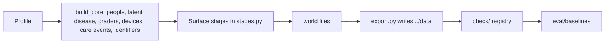

# problem_simulation

The factory for the Version 02 world. It generates [../data](../data/README.md) from a seed, checks that every planted problem traces to one cause, scores reference baselines, and serves the mock APIs. It is not the client brief. Participants work from `../data`; facilitators and maintainers work here.

Week 1 gold is `truth/gold/discovery.json`, written by `simulation/eval/discovery_gold.py` on every build. Week 2 gold is `truth/gold/enterprise.json` and `truth/gold/identity_records.parquet`, written by `simulation/eval/enterprise/` on every build. Week 3 gold is `truth/gold/evidence.json` and `truth/gold/evidence_extract.parquet`, written by `simulation/eval/evidence/` on every build. Week 4 gold is `truth/gold/graph.json` and `truth/gold/graph_reconciliation.parquet`, written by `simulation/eval/graph/` on every build. The week 4 chase list is every local id whose latest referral message has no seen date, which is wider than the overdue cohort. Week 5 gold is `truth/gold/agent.json`, `truth/gold/agent_backlog.parquet`, and `truth/gold/agent_sweep.parquet`, written by `simulation/eval/agent/` on every build. The week 5 drop adds `delivery_assumptions.md`, which states the durations the pilot date depends on and states no date. The reference solutions that must pass the checkers live in [Week 01](<../Week 01 - Problem Discovery/reference_discovery/README.md>), [Week 02](<../Week 02 - Enterprise Data/reference_enterprise/README.md>), [Week 03](<../Week 03 - Retrieval and ML Evidence/reference_evidence/README.md>), [Week 04](<../Week 04 - Graph Retrieval and Integration/reference_graph/README.md>), and [Week 05](<../Week 05 - The Agent and the Re-plan/reference_agent/README.md>). Participants leave them closed.

| Path | What it is |
|---|---|
| `simulation/` | The generator, checks, eval, scorer, baselines, and hardness audit (Python package) |
| `serve/` | Mock REST APIs over a built data folder. See [serve/README.md](serve/README.md). |
| `PLAN.md` | The design: outcomes, audience, hidden world model, surfaces, drops, milestones |
| `requirements.txt` | Python dependencies |
| `build/` | Output of non-practice profiles (gitignored) |

## Quick start

From this folder:

```text
pip install -r requirements.txt
python -m simulation                       # practice profile, writes ../data
python -m simulation --profile small       # fast profile, writes build/data-small
python -m simulation --profile assessment  # held-out seed, writes build/data-assessment
python -m pytest simulation/tests serve/tests
```

A practice build takes about six minutes with the repeat check (`--no-repeat` halves it). It writes every surface, runs every check, rebuilds with the same seed to compare fingerprints, then scores the baselines. It prints `Validation passed.` only when every planted trap traces to one cause.

## Profiles

`simulation/config/*.yaml`. Output paths are relative to this folder.

| Profile | Seed | Scale | Output | Use |
|---|---|---|---|---|
| `practice` | 20261001 | 2.25 (about 45,000 people) | `../data` | The published drop |
| `assessment` | 7310, or `HARTLAND_ASSESSMENT_SEED` | 2.0 | `build/data-assessment` | Held out. Renamed sites and shifted dates. |
| `small` | 11 | 0.3 | `build/data-small` | Fast checks while editing; the tests use it |
| `team-1` to `team-4` | 30101 to 30404 | 2.25 | `build/data-team-N` | Same structure, own seed, so teams cannot share answers |

Set `volume: true` in a profile to add about ten million SMS and audit rows, written as year partitions.

## How the world is built



1. `build.build_core` makes the hidden world: people and identity defects, HbA1c and latent per-eye disease, graders with bias, drift, and a rota change, cameras and firmware, attendance behaviour, and care events from October 2018 to the October 2026 snapshot.
2. `stages.py` runs each surface stage in order: workforce and devices, corpus, estate (the new systems), economics, stakeholders, ML evidence, delivery, drops. Each stage only adds files, small fingerprinted tables, and gold to the world.
3. `export.py` writes `truth/`, `corpus/`, the original system exports, every stage file, `truth/gold/`, and `eval/cases.jsonl`.
4. `check/registry.py` lists one check module per surface. A check fails when a planted problem is missing or does not trace to its cause.
5. `eval/baselines` scores what a strong generalist would build first. `python -m simulation.audit` requires each role's best baseline to stay below a pass rate of 0.5 on both the practice and assessment seeds.

## Code map

Every module does one thing and stays under about 200 lines.

| Package | What it owns |
|---|---|
| `config/` | Profiles and the active profile |
| `world/` | Clock and key dates, sites, staff and vendors, the incident and change timeline, the engagement calendar, quotas |
| `people/` | Population, identifiers, check digits, name variants, twins, households, silent movers |
| `disease/` | HbA1c trajectories, latent progression, state lookup |
| `workforce/` | Grader roster, hours, capacity, the grading queue, sessions |
| `devices/` | Camera inventory, firmware history, image quality |
| `care/` | Attendance, placement, grading, letters, referrals, breach attribution |
| `systems/` | The original exports: registry, PACS, shared folder, grader, letters, ophthalmology, vendor, warehouse, interface notes |
| `estate/`, `faults/` | Booking, SMS, call centre, lab, service desk, identity, audit, finance, complaints, clinic letters; one module per fault type |
| `architecture/` | EA current state, components, model register, data catalogue, lineage, threat gold |
| `policy/` | Clauses, documents, frames, rendering |
| `corpus/` | One module per document family; `add.py` is how any stage adds a document |
| `prose/` | Fact specs, the LLM prose cache, the author tool, the fact checker, PDF, DOCX, XLSX, and scan renderers |
| `economics/` | Unit costs, harm, budgets, opportunity values, dependencies, the reminder baseline |
| `stakeholders/` | One module per persona, the interview simulator, transcripts, threads, board paper, research, workshop |
| `ml/` | Vendor retrospective set, operating points, adjudication, did-not-attend table, numpy baselines, judge calibration |
| `delivery/`, `drops/` | Tracker, roadmap, risks, freezes, RACI, gates, procurement, benefits, accessibility, contracts; one module per weekly drop |
| `check/` | One check module per surface |
| `eval/` | One case module per surface, `score/` (the scorer), `baselines/`, `discovery_gold.py` (the Week 1 key), `enterprise/` (the Week 2 key), `evidence/` (the Week 3 key), `graph/` (the Week 4 key), and `agent/` (the Week 5 key, written to `truth/gold/agent.json`, `agent_backlog.parquet`, and `agent_sweep.parquet`) |
| `audit/` | The hardness audit and the human dry-run protocol (`audit/DRY_RUN.md`) |
| `tests/` | Unit tests |

## Tools

| Command | What it does |
|---|---|
| `python -m simulation.prose status` | How many documents have cached LLM prose, by family |
| `python -m simulation.prose author --profile practice` | Writes LLM prose for every spec without a cached body. Reads `HARTLAND_LLM_*` or `OPENAI_*` settings, or a `.env` file (see `simulation/prose/settings.py`). Commit `simulation/prose/cache/` afterwards. |
| `python -m simulation.prose prune` | Removes cache entries whose facts changed |
| `python -m simulation.stakeholders.interview --persona cdo` | The interview simulator |
| `python -m simulation.eval.score answers.jsonl --cases ../data/eval/cases.jsonl` | Scores answers by outcome, role, surface, and budget tier |
| `python -m simulation.eval.baselines --profile practice` | Re-scores the baselines |
| `python -m simulation.audit` | The hardness rule on both audited seeds |
| `python -m serve --system all` | Mock APIs over `../data` |

Builds never call an LLM. A document whose spec has no cached prose uses its seeded template draft, and both pass the same fact check: every planted fact present, nothing extra.

## Rules the generator keeps

- Fictional people only. No photograph bytes are ever written.
- No person id (`P` + seven digits) outside `truth/` and `eval/`.
- The clinical safety owner stays blank in `handover/owners.csv`; the pilot stays stopped.
- Same seed, same world. All randomness comes from the profile seed.
- Version 01 is not changed.
