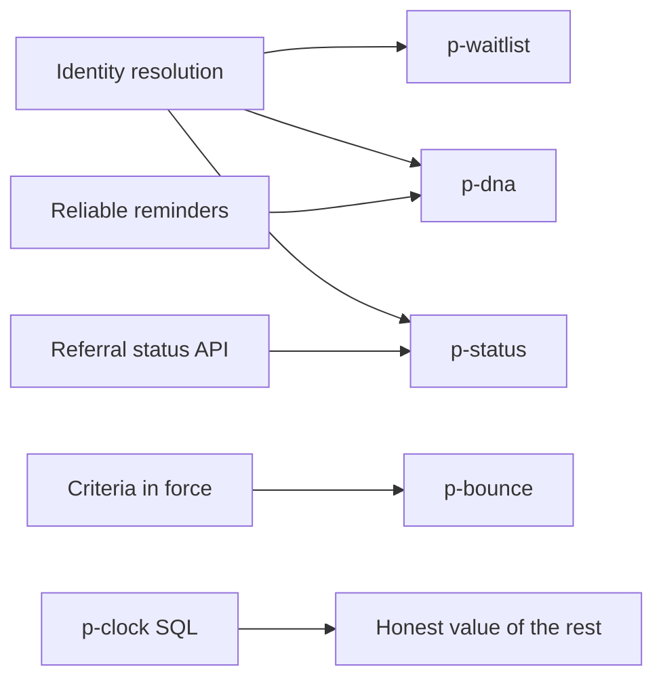

# Real problems

Facilitators only. Participants meet symptoms and claims. The nine problems below are the causes those claims come from. Approach choice on Week 1, Day 2 is graded against this table (`chk-w1-approach`).

Rates are practice-profile targets. Gold stores the seed's actual rate. Lesson prose cites the id, not the percent.

## The nine

| Id | What is wrong | Cause in truth | Approach that fits | Trap |
|---|---|---|---|---|
| `p-bounce` | About 27% of referrals are returned | PHC templates still emit criteria v3 while v4 is draft; PHC shorthand; wrong sub-specialty | Extract to a schema, retrieve the clause in force, coordinator approves the return. Later a LoRA adapter on `local-small` | Returning on v4 before it is in force, or returning with no clause id |
| `p-waitlist` | About 18% of waitlist rows are duplicate or stale | Split identity, re-referral after a bounce, seen elsewhere, late death flags | Rules and probabilistic matching; a model only for hard pairs; outreach asks if the patient still needs the visit | Merging twins or a mother and newborn |
| `p-dna` | DNA reaches about 22% in some clinics | Long lead time, failed reminders on foreign or stale numbers, daytime slots in Ramadan, travel from `d-rim` | Gradient boosting, person-grouped time split | `appointment_status_final` leaks the label; a random split looks excellent; overbooking harms `d-rim` and residents |
| `p-status` | About 58% of coded calls ask for referral status | Pending referrals are hidden from the patient channel | An assistant with an identity check and a status tool | The vendor's containment rate counts abandoned chats as handled |
| `p-slots` | About 9% of slots go unused | Late cancellation, including insurance lapse, and consultant leave never backfill | An event workflow and rules. Slot allocation does not use a language model | Holding a slot with an LLM "judgment" races and double-books |
| `p-clock` | The dashboard understates waiting | The mart starts the clock at booking, not at referral | Correct the SQL. No model | Treating the dashboard as the baseline for a business case |
| `p-info` | Patients reach the contact center for hours, preparation, and required documents | The answer is in superseded or facility-specific PDFs | Retrieval filtered by version, date, site, and audience | Citing a draft, a superseded circular, or a staff-only document to a patient |
| `p-forecast` | Session plans miss peaks | Season, Eid, Ramadan, and campaigns move demand | A seasonal-naive baseline. A heavier model must beat it on a later window | Fitting a complex model on the same months it is scored on |
| `p-triage` | The sponsor wants the assistant to set clinical urgency | Forbidden. The medical director and `pol-clinical-safety` assign urgency to a clinician | Route red-flag phrases to a human. Build nothing that writes an urgency grade | Shipping the sponsor's favorite use case |

## Value

Each problem has a value record in truth:

`baseline_cost_sar`, `gain_low_sar`, `gain_high_sar`, `data_readiness`, `risk_discount`, `weeks_to_value`, `blockers`, `depends_on`, `must_cite`.

Costs come from the catalog keys in [04 Systems](04-systems-and-environments.md): missed slot, return cycle, coordinator hour, contact-center minute, SMS, label, GPU hour. Waiting uses a teaching harm weight, not a clinical one.

`p-triage` can show the largest gross saving and still have a blocker that no design removes. `p-clock` is cheap and changes the value of every other problem, because it fixes the baseline. Identity resolution and a patient-visible referral status unlock `p-waitlist`, `p-dna`, and `p-status`.

A ranking has no single correct order. Gold is the value range, the dependency edges, and the facts a defensible ranking must cite. A ranking that puts a blocked problem first, with the block unaddressed, fails `chk-w1-brief`.

## Dependencies

## What leaders say first

These are claims, and they are the opening lines of the persona cards in [06 Engagement](06-engagement-and-delivery.md).

| Who | Opening claim | What is off |
|---|---|---|
| `cdo` | The virtual front desk, including triage, is the program | Triage is blocked, and the date ignores procurement |
| `vendor` | Containment is about 70% | Abandoned chats are in the numerator, and the population is not Al-Waha |
| `bi-lead` | Waits fell last year | The clock starts at booking |
| `access-mgr` | No-shows are the largest cost | Returns and duplicate waitlist rows cost more once identity is counted |
| `phc-lead` | The hospital returns referrals arbitrarily | The template pack is still on criteria v3 |

## Where the problems surface

Interviews can reveal the blockers early: the DPO's unsigned ruling, and the v4 draft. Teams that record those facts are ready for `rel-w3d2` and `rel-w3d3`. Teams that do not still receive the files on the day. The reward is preparation, not a hidden score bonus.
