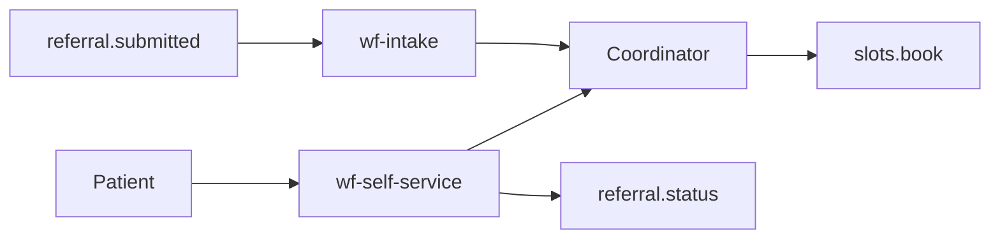

# 07 — The diagram

[Chapter 06](06-the-agent.md) wrote the trace. This chapter fills the architecture and the design. The checks read both files. The blocks below are the pages that make that part of the checks pass. You still read what each section is, and you still keep clinical urgency with a clinician.

## Copy the blanks

Open a terminal in the course folder, the same way as chapter 01. Then run:

```text
python "Week 01/Day 05/Student_Copy/prepare_work.py" pages
```

You should see `Copied the blank pages to work/.`

The word `pages` stays outside the quotation marks. It is the second word on that line. If the script prints `Use: python prepare_work.py    or    python prepare_work.py pages`, you put `pages` inside the quotes. Run the line again with `pages` after the closing quote.

That copies four files:

- [work/architecture.md](work/architecture.md)
- [work/design.md](work/design.md)
- [work/readout.md](work/readout.md)
- [work/trace-note.md](work/trace-note.md)

This chapter fills the first two. [Chapter 08](08-the-readout.md) fills the other two. The copied files are blank headings. Do not type into the blanks. The paste in this chapter replaces `architecture.md` and `design.md`. Chapter 08 replaces `readout.md` and `trace-note.md`. A second run of that command replaces all four, including a page you already filled. Run it once.

If the command says to run `prepare_work.py` first with no extra word, do that from the course folder, then run the `pages` command again.

## Replace the architecture

The diagram has to show `wf-intake`, `wf-self-service`, the tools, and the zones. It also has to keep a human step. The check says `the diagram has no human step` when the diagram section has none of the words coordinator, human, or approval. It does not name a missing box.

[zones.md](packet/kickoff/world/zones.md) names `zone-hospital`, `zone-private`, and `zone-public`. [mcp-cluster.json](packet/day4/tools/mcp-cluster.json) names the six tools. The coordinator is the human step. A return and a booking wait there.

Open [work/architecture.md](work/architecture.md). Select the whole file. Delete it. Paste the block below. Save.

Copy every line inside the block, including the lines that begin with three backticks. Those lines are part of the file. They open and close the diagram. If you are reading this page as a raw file, the block itself is wrapped in a line of four backticks at the top and a line of four backticks at the bottom. Do not copy those two lines of four backticks.

After you save, search the file for `Coordinator` and for `zone-hospital`. Both have to be there. If `Coordinator` is missing, paste the block again.

This block replaces `work/architecture.md` only.

````text
# Architecture

## Diagram



The coordinator is the human step. A return and a booking wait there.

## Zones

- zone-hospital
- zone-private
- zone-public

## Tools

referral.status, referral.return, slots.offer, slots.book, sms.send, safety.redirect
````

## Replace the design

The design names the approach and what this proof will not build. Clinical urgency stays with a clinician. The check says `the design does not leave urgency with a clinician` when that section is missing either word.

Do not write that the assistant sets clinical urgency. Do not write that triage is already approved. Do not write that the external model may receive identified patient data. The check says `design contains a banned sentence` and does not print the sentence.

Stage 2 is a table. The columns are `topic`, `what is still open`, and `citation`. Keep the pipe characters. A paste that drops them leaves the cells empty. The check then says `the design note is missing a required fact`. It does not name the fact.

The four cells below are for reading. Do not paste this table into the file. The block under it is the file.

| topic | what is still open | citation |
| --- | --- | --- |
| residency | Patient data stays off ext-large. [zones.md](packet/kickoff/world/zones.md) names that model on `zone-public`. [dpo.md](packet/kickoff/personas/dpo.md) keeps patient data in the private cloud. | dpo |
| identity | Duplicate rows and a split identity on p-waitlist. [problems.md](packet/carried/problems.md) names `p-waitlist`. | ea |
| criteria | The v4 criteria are still a draft. [crit-endo-v4.md](packet/carried/criteria/crit-endo-v4.md) says draft. | crit-endo-v4 |
| hospital | h-ain has no live slot API. [pol-sla.md](packet/carried/policy/pol-sla.md) says `h-ain` has no slot API. [ea.md](packet/kickoff/personas/ea.md) will not promise a live slot where none exists. | ea |

The approach uses `p-status`, `p-clock`, `p-slots`, and `p-waitlist` from [problems.md](packet/carried/problems.md). It cites `cdo` and `pol-approval`. What this proof will not build is `p-triage`. A clinician assigns every clinical urgency.

Open [work/design.md](work/design.md). Select the whole file. Delete it. Copy the lines inside the block below, including every pipe character. Paste. Save. Do not paste the reading table above.

After you save, the file has four headings: Approach, What we will not build, Stage 2, and Citations. The Stage 2 table still has the header `topic`, `what is still open`, and `citation`.

This block replaces `work/design.md` only.

```text
# Design

## Approach

`p-status` is an assistant with a status tool. `p-clock` and `p-slots` need no model. `p-waitlist` is where identity still splits people. Citation: cdo and pol-approval.

## What we will not build

This proof will not build `p-triage`. A clinician assigns every clinical urgency.

## Stage 2

| topic | what is still open | citation |
| --- | --- | --- |
| residency | Patient data stays off ext-large. | dpo |
| identity | Duplicate rows and a split identity on p-waitlist. | ea |
| criteria | The v4 criteria are still a draft. | crit-endo-v4 |
| hospital | h-ain has no live slot API. | ea |

## Citations

pol-stage-gate
```

Next: [08 — The readout](08-the-readout.md).
